# Prompt 7B · Modelo de datos: verificación, Athlete Discovery y shortlists

Migraciones: `20261120000400_org_roles_v2.sql` y `20261120000500_verification_discovery_shortlists.sql` (solo aditivas, con reversión documentada en la cabecera). Pruebas: bloque «Prompt 7B» de `supabase/tests/rls.test.mjs` (33 comprobaciones nuevas).

**Principio:** evolucionar lo que ya existía, sin sistemas paralelos. `organizations`, `organization_members`, `org_programs`, `recruiting_needs`, `org_shortlists`, `org_shortlist_members`, `org_notes`, `org_tasks`, `org_candidates` y `audit_logs` ya existían y se amplían. Lo nuevo solo cubre conceptos que no existían.

## Diagrama entidad-relación

```mermaid
erDiagram
  profiles ||--o{ organization_members : "membresía activa"
  organizations ||--o{ organization_members : ""
  organizations ||--o{ organization_membership_records : "historial (suspendida, revocada, abandonada)"
  organizations ||--o{ organization_domains : "dominios"
  organizations ||--o{ org_programs : "programas"
  organization_members ||--o{ program_memberships : "acceso por programa"
  org_programs ||--o{ program_memberships : ""
  profiles ||--o{ verification_requests : "solicitante"
  verification_requests ||--o{ verification_checks : "comprobaciones"
  verification_requests ||--o{ verification_evidence : "evidencias"
  verification_requests ||--o{ verification_decisions : "decisiones (append-only)"
  profiles ||--o{ email_verifications : "correo institucional"
  athlete_profiles ||--o| athlete_discovery_settings : "visibilidad en Discovery"
  athlete_profiles ||--o{ passport_field_policies : "ver / filtrar / Match / exportar"
  organizations ||--o{ recruiting_needs : ""
  organizations ||--o{ org_saved_searches : ""
  organizations ||--o{ org_shortlists : ""
  org_shortlists ||--o{ org_shortlist_members : "atleta (sin duplicados)"
  org_shortlists ||--o{ shortlist_access : "compartida con"
  org_shortlist_members ||--o{ org_shortlist_member_labels : ""
  org_labels ||--o{ org_shortlist_member_labels : ""
  org_shortlist_members }o--o| org_candidates : "promovido a (explícito)"
  organizations ||--o{ org_assignment_log : "historial de asignaciones"
  organizations ||--o{ audit_logs : "auditoría central"
```

## Entidades

| Entidad | Qué es | Cardinalidad clave | Notas |
|---|---|---|---|
| `organizations` (+) | Institución u organización | 1 org : N miembros, programas, dominios | Nuevos: `normalized_name`, `org_status` (active/suspended/compromised/closed), `claim_status` (unclaimed/claim_pending/claimed), `source` (user_created/imported/admin), `external_id`, `last_reviewed_at`. **Importada ≠ reclamada ≠ verificada**: tres campos distintos. College Scorecard sigue en `institutions` y se enlaza con `institution_id`. |
| `organization_domains` | Dominios autorizados | N por organización; un dominio verificado pertenece a una sola | Solo Gala verifica o revoca. `domain_matches()` compara igual o subdominio con límite de punto. |
| `organization_members` (+) | Membresía **activa** | PK (organización, usuario): sin duplicados | Nuevos: `declared_role`, `role_verification`, `affiliation_verification` (unverified/email_verified/verified), `invited_by`, `invitation_source`, `program_scope` (all/selected). Los niveles de verificación solo los cambia Gala. |
| `organization_membership_records` | Historial de estados | N por persona y organización | invited, pending, suspended, revoked, left, rejected, reinstated. Toda salida deja registro y auditoría. |
| `program_memberships` | Acceso a un programa concreto | Una activa por (org, usuario, programa) | Concede/revoca con quién y cuándo. La caché `program_ids` + `program_scope` se recalcula; revocar el último programa **no** abre todos. |
| Roles | `org_member_role` + `org_role_caps()` | — | Catálogo SQL versionado (`org_policy_version()`). Nuevos: `athletic_director`, `analyst`, `viewer`. La interfaz solo refleja (`ROLE_CAPS`). |
| `verification_requests` | Solicitud verificable | Una abierta por (persona, org, tipo) | Tipos: identity, institutional_email, organization_claim, organization_affiliation, program_affiliation, role, domain. Estados: draft → submitted → pending_evidence → under_review → approved / partially_approved / rejected / expired / revoked / suspended. |
| `verification_checks` | Cada comprobación | N por solicitud | institutional_email, domain_match, admin_invitation, manual_review, official_staff_directory, organization_confirmation, supporting_document. |
| `verification_evidence` | Evidencia | N por solicitud | Solo URL oficial https o ruta de almacenamiento privado. Nunca el documento en texto. Clasificación de confidencialidad. |
| `verification_decisions` | Historial de decisiones | N por solicitud, **inmutable** | Estado anterior y nuevo, motivo, revisor, restricciones. |
| `email_verifications` | Correo institucional | N por persona | Solo el hash SHA-256 del token (columna no legible por el usuario), caduca a 30 min, un solo uso, máx. 5 intentos y 5 solicitudes al día. El token lo emite **solo el servidor** (`email_verification_issue`, rol `service_role`). |
| `athlete_discovery_settings` | Visibilidad en Discovery | 0..1 por atleta | off, verified_organizations o selected_organization_types, regiones y periodo. Sin fila: comportamiento actual (abierto a oportunidades + visibilidad del Passport). |
| `passport_field_policies` | Política por bloque | Una por atleta y bloque | Bloques: sport, physical, academics, stats, videos, goals. Ver ≠ filtrar ≠ Match ≠ comparar ≠ exportar. Sin fila: filtrar/Match/comparar sí, exportar no; menores sin filtro por académico ni estadísticas. |
| `discovery_usage` | Cuota anti-enumeración | Una por persona y día | 300 búsquedas al día. |
| `org_saved_searches` | Búsqueda guardada de la organización | N por organización | Filtros como objeto validado (claves permitidas y deporte obligatorio), con versión. Privadas por defecto. |
| `org_shortlists` (+) | Lista de seguimiento | N por organización/programa | Nuevos: descripción, clase, deporte, oportunidad, `status` (active/archived/deleted), visibilidad private/shared/program/team. |
| `shortlist_access` | Compartir con personas | Una por (lista, persona) | editor / contributor / viewer; revocable; solo con miembros de la organización con permiso de shortlists. Sin enlaces públicos. |
| `org_shortlist_members` (+) | Atleta en una lista | PK (lista, atleta): sin duplicados | Nuevos: `source`, `last_reviewed_at`, `internal_label`, `promoted_candidate_id`, `promoted_at`. `review_status`: to_review, reviewing, reviewed, needs_info. **Nunca** oferta ni comprometido. No copia datos del Passport. |
| `org_labels` + `org_shortlist_member_labels` | Etiquetas internas | Únicas por organización/programa | Nunca visibles para el atleta. |
| `org_notes` (+) | Notas internas | — | Vinculables a la lista, marca de editada, borrado lógico y rechazo de contenido ejecutable. |
| `org_assignment_log` | Historial de asignaciones | — | Una asignación exige ser miembro con permiso de candidatos. |
| `org_tasks` (+) | Tareas (se reutilizan) | — | Se vinculan a lista, candidato o necesidad. |
| `audit_logs` (+) | Auditoría central | — | Nuevos: organización, programa, rol, motivo y clasificación (normal/sensitive/security). Sin secretos ni documentos. Compliance y admins leen la de su organización. |

Ya existían y se reutilizan: taxonomías (`sports`, `sport_positions`, `sport_stat_definitions`), estadísticas por deporte y temporada (`athlete_statistics`), necesidades estructuradas (`recruiting_needs`: posiciones, clases, altura mínima, vídeo, académico documentado, países), tareas (`org_tasks`) y candidatos del pipeline (`org_candidates`, uno por organización y atleta).

## Flujos (funciones transaccionales)

1. **Verificación:** `email_verification_start` (usuario) → `email_verification_issue` (servidor: el token solo viaja por correo) → `email_verification_confirm` (usuario). Después `verification_submit` (registra la comprobación de dominio) → `verification_decide` (solo revisor de Gala). Aprobar crea o confirma la membresía con rol verificado; revocar o suspender retira el acceso al instante y deja registro.
2. **Membresía:** `org_suspend_member` / `org_reinstate_member` (con motivo). Retirar a alguien siempre deja `organization_membership_records` + `audit_logs`.
3. **Discovery:** `discover_athlete_ids(org, filtros, página)`. Organización verificada con permiso `discover`, deporte obligatorio, máx. 20 páginas, claves de filtro cerradas, y cada filtro solo actúa sobre atletas que permiten filtrar ese bloque. Devuelve solo identificadores y los bloques que no pueden usarse para el encaje. La ficha se lee de la vista enmascarada `athlete_directory`. El encaje inverso (`needFit`) trata esos bloques como desconocidos.
4. **Shortlist → Pipeline:** `shortlist_promote(lista, atleta, necesidad?, oportunidad?)` valida permisos, privacidad **actual**, necesidad u oportunidad de la organización y duplicados. Después crea o reactiva `org_candidates`, guarda el vínculo, registra actividad y auditoría. La fila de la shortlist no se transforma.

## Constraints e índices principales
- Dominio verificado único global; un dominio principal por organización; formato de host validado.
- Membresía activa única (PK); concesión de programa activa única; una solicitud abierta por persona, organización y tipo.
- Atleta único por lista; candidato único por organización y atleta; programa de la lista dentro de su organización (`program_in_org`).
- Asignaciones solo a miembros con permiso; decisiones de verificación inmutables.
- Índices: `normalized_name`, `(source, external_id)`, dominios, miembros por usuario, programas por usuario, cola de verificación, auditoría por organización y fecha, asignados en listas. Discovery filtra con la PK y los índices existentes de `athlete_profiles`.

## Seguridad (RLS)
- Organizaciones aisladas por `org_can` (miembro activo + rol + organización activa + verificada + programa).
- Verificaciones: el solicitante ve las suyas; los revisores, las suyas y las asignadas; el admin de la organización, las de su organización. Las evidencias solo las ven su autor y Gala.
- Discovery solo con organizaciones verificadas y miembros con permiso. Un campo privado o no filtrable no puede usarse para filtrar.
- Shortlists según dueño, accesos concedidos, programa u organización. «viewer» lee pero no escribe.
- Notas, etiquetas y asignaciones solo son internas de la organización.

## Migración de datos existentes
- `institution_claims` → `verification_requests` (`organization_claim`) con su estado, revisor y nota. La tabla original se conserva.
- `organization_members.program_ids` → `program_memberships` (fecha de alta como fecha de concesión) y `program_scope`.
- Organizaciones con miembros pasan a `claim_status = claimed`. Las shortlists archivadas pasan a `status = archived`.
- Las listas personales (`saved_athletes`) **no** se convierten automáticamente en shortlists de organización: pertenecen a una persona, no a un equipo.

## Eventos
- **Auditoría** (`audit_logs`): verification_requested / approved / rejected / revoked / suspended, email_verified, membership_revoked / left / suspended / reinstated, program_access_granted / revoked, athlete_promoted_to_pipeline.
- **Producto** (`product_events`, sin datos sensibles): athlete_search_performed, athlete_search_saved, athlete_promoted_to_pipeline, verification_requested. `athlete_discovered` se mantiene para el embudo existente.

## Confirmaciones
- **Sin datos ficticios:** las migraciones no insertan organizaciones, atletas ni resultados inventados. Solo migran datos existentes.
- **Aislamiento entre organizaciones:** probado (otra universidad no ve shortlists, búsquedas guardadas, notas ni el estado de verificación de otro).
- **La privacidad se aplica a búsqueda y filtros:** probado (Discovery desactivado, tipo de organización, campo visible pero no filtrable, campo no utilizable para Match, menor sin filtro académico).

## Pendiente para 7C (experiencia móvil) y siguientes
Pantallas de solicitud de verificación y del revisor, envío del correo institucional (requiere `SUPABASE_SECRET_KEY` y un proveedor de correo en el servidor), gestión de accesos de shortlists, etiquetas y búsquedas guardadas en la interfaz, y herramientas de Gala AI sobre estas funciones.
