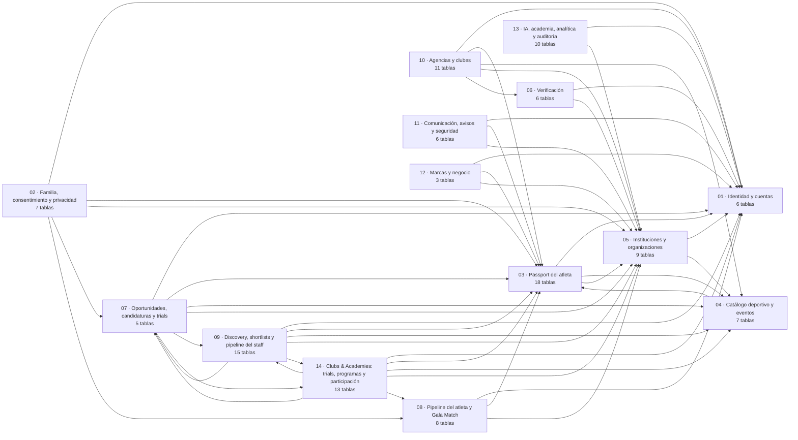

<!-- Generado por scripts/erd/generate.mjs a partir de las migraciones. No editar a mano: `npm run erd`. -->
# 00 · MASTER · Mapa de datos de The Gala Alliance

**124 tablas** en 14 dominios, todas con RLS (124/124).
Clasificación: Pública 16 · Interna 34 · Personal 59 · Sensible 15 · con posibles datos de menores: 44.

Cómo leerlo: cada dominio tiene su fichero con el diagrama AS-IS (columnas reales), el inventario y el TO-BE. La arquitectura, las reglas y el plan están en [`docs/DATA_ARCHITECTURE.md`](../DATA_ARCHITECTURE.md).

## Dominios y dependencias

Una flecha A → B significa que tablas de A apuntan (FK) a tablas de B.

## Entidades núcleo

```mermaid
erDiagram
  PROFILES ||--o{ ATHLETE_PROFILES : "user_id"
  PROFILES |o--o{ PARENT_ATHLETE_LINKS : "athlete_id"
  PROFILES |o--o{ PARENT_ATHLETE_LINKS : "parent_id"
  INSTITUTIONS |o--o{ ORGANIZATIONS : "institution_id"
  ORGANIZATIONS ||--o{ ORGANIZATION_MEMBERS : "organization_id"
  PROFILES ||--o{ ORGANIZATION_MEMBERS : "user_id"
  ORGANIZATIONS ||--o{ ORG_PROGRAMS : "organization_id"
  INSTITUTIONS |o--o{ VERIFICATION_REQUESTS : "institution_id"
  ORGANIZATIONS |o--o{ VERIFICATION_REQUESTS : "organization_id"
  ORG_PROGRAMS |o--o{ VERIFICATION_REQUESTS : "program_id"
  PROFILES ||--o{ VERIFICATION_REQUESTS : "subject_user"
  PROFILES |o--o{ OPPORTUNITIES : "moderated_by"
  RECRUITING_NEEDS |o--o{ OPPORTUNITIES : "need_id"
  ORGANIZATIONS ||--o{ OPPORTUNITIES : "organization_id"
  ORG_PROGRAMS |o--o{ OPPORTUNITIES : "program_id"
  ORG_TEAMS |o--o{ OPPORTUNITIES : "team_id"
  PROFILES |o--o{ OPPORTUNITIES : "updated_by"
  ATHLETE_PROFILES ||--o{ APPLICATIONS : "athlete_id"
  PROFILES |o--o{ APPLICATIONS : "decided_by"
  OPPORTUNITIES ||--o{ APPLICATIONS : "opportunity_id"
  ORGANIZATIONS ||--o{ APPLICATIONS : "organization_id"
  ATHLETE_PROFILES ||--o{ SAVED_ITEMS : "athlete_id"
  APPLICATIONS |o--o{ ORG_CANDIDATES : "application_id"
  ATHLETE_PROFILES ||--o{ ORG_CANDIDATES : "athlete_id"
  RECRUITING_NEEDS |o--o{ ORG_CANDIDATES : "need_id"
  OPPORTUNITIES |o--o{ ORG_CANDIDATES : "opportunity_id"
  ORGANIZATIONS ||--o{ ORG_CANDIDATES : "organization_id"
  ORG_PROGRAMS |o--o{ ORG_CANDIDATES : "program_id"
  OPPORTUNITY_REGISTRATIONS |o--o{ ORG_CANDIDATES : "registration_id"
  ORG_TEAMS |o--o{ ORG_CANDIDATES : "team_id"
  RECRUITING_NEEDS |o--o{ ORG_SHORTLISTS : "need_id"
  OPPORTUNITIES |o--o{ ORG_SHORTLISTS : "opportunity_id"
  ORGANIZATIONS ||--o{ ORG_SHORTLISTS : "organization_id"
  ORG_PROGRAMS |o--o{ ORG_SHORTLISTS : "program_id"
  ATHLETE_PROFILES ||--o{ ORG_SHORTLIST_MEMBERS : "athlete_id"
  ORGANIZATIONS ||--o{ ORG_SHORTLIST_MEMBERS : "organization_id"
  ORG_CANDIDATES |o--o{ ORG_SHORTLIST_MEMBERS : "promoted_candidate_id"
  ORG_SHORTLISTS ||--o{ ORG_SHORTLIST_MEMBERS : "shortlist_id"
  OPPORTUNITIES |o--o{ RECRUITING_NEEDS : "opportunity_id"
  ORGANIZATIONS ||--o{ RECRUITING_NEEDS : "organization_id"
  ORG_PROGRAMS |o--o{ RECRUITING_NEEDS : "program_id"
  ORG_TEAMS |o--o{ RECRUITING_NEEDS : "team_id"
  ORGANIZATIONS ||--o{ RECRUITING_CASES : "agency_id"
  ATHLETE_PROFILES ||--o{ RECRUITING_CASES : "athlete_id"
  INSTITUTIONS |o--o{ RECRUITING_CASES : "institution_id"
  ORGANIZATIONS ||--o{ AGENT_REPRESENTATIONS : "agency_id"
  PROFILES ||--o{ AGENT_REPRESENTATIONS : "agent_id"
  ATHLETE_PROFILES ||--o{ AGENT_REPRESENTATIONS : "athlete_id"
  ORGANIZATIONS |o--o{ OPPORTUNITY_REGISTRATIONS : "agency_id"
  APPLICATIONS |o--o{ OPPORTUNITY_REGISTRATIONS : "application_id"
  ATHLETE_PROFILES ||--o{ OPPORTUNITY_REGISTRATIONS : "athlete_id"
  OPPORTUNITIES ||--o{ OPPORTUNITY_REGISTRATIONS : "opportunity_id"
  ORGANIZATIONS ||--o{ OPPORTUNITY_REGISTRATIONS : "organization_id"
  APPLICATIONS |o--o{ PROGRAM_ENROLLMENTS : "application_id"
  ATHLETE_PROFILES ||--o{ PROGRAM_ENROLLMENTS : "athlete_id"
  OPPORTUNITIES ||--o{ PROGRAM_ENROLLMENTS : "opportunity_id"
  ORGANIZATIONS ||--o{ PROGRAM_ENROLLMENTS : "organization_id"
  ORGANIZATIONS ||--o{ ORG_TEAMS : "organization_id"
  ORG_PROGRAMS ||--o{ ORG_TEAMS : "program_id"
  ATHLETE_PROFILES ||--o{ CONTACT_REQUESTS : "athlete_id"
  PROFILES |o--o{ CONTACT_REQUESTS : "guardian_approved_by"
  ORGANIZATIONS ||--o{ CONTACT_REQUESTS : "organization_id"
  PROFILES ||--o{ CONTACT_REQUESTS : "requested_by"
  ATHLETE_PROFILES ||--o{ CLUB_ROSTER : "athlete_id"
  ORGANIZATIONS ||--o{ CLUB_ROSTER : "organization_id"
```

## Índice

| Dominio | Tablas | Cambios previstos |
|---|---|---|
| [01 · Identidad y cuentas](./01-identidad.md) | 6 | — |
| [02 · Familia, consentimiento y privacidad](./02-familia-privacidad.md) | 7 | — |
| [03 · Passport del atleta](./03-passport.md) | 18 | — |
| [04 · Catálogo deportivo y eventos](./04-catalogo.md) | 7 | — |
| [05 · Instituciones y organizaciones](./05-organizaciones.md) | 9 | — |
| [06 · Verificación](./06-verificacion.md) | 6 | `institution_claims` |
| [07 · Oportunidades, candidaturas y trials](./07-oportunidades.md) | 5 | — |
| [08 · Pipeline del atleta y Gala Match](./08-pipeline-atleta.md) | 8 | `saved_items` |
| [09 · Discovery, shortlists y pipeline del staff](./09-recruiting-staff.md) | 15 | `saved_athletes`, `saved_searches` |
| [10 · Agencias y clubes](./10-agencias-clubes.md) | 11 | `club_roster_invites` |
| [11 · Comunicación, avisos y seguridad](./11-comunicacion.md) | 6 | — |
| [12 · Marcas y negocio](./12-marcas-negocio.md) | 3 | — |
| [13 · IA, academia, analítica y auditoría](./13-ia-analitica.md) | 10 | — |
| [14 · Clubs & Academies: trials, programas y participación](./14-clubs-academias.md) | 13 | — |
