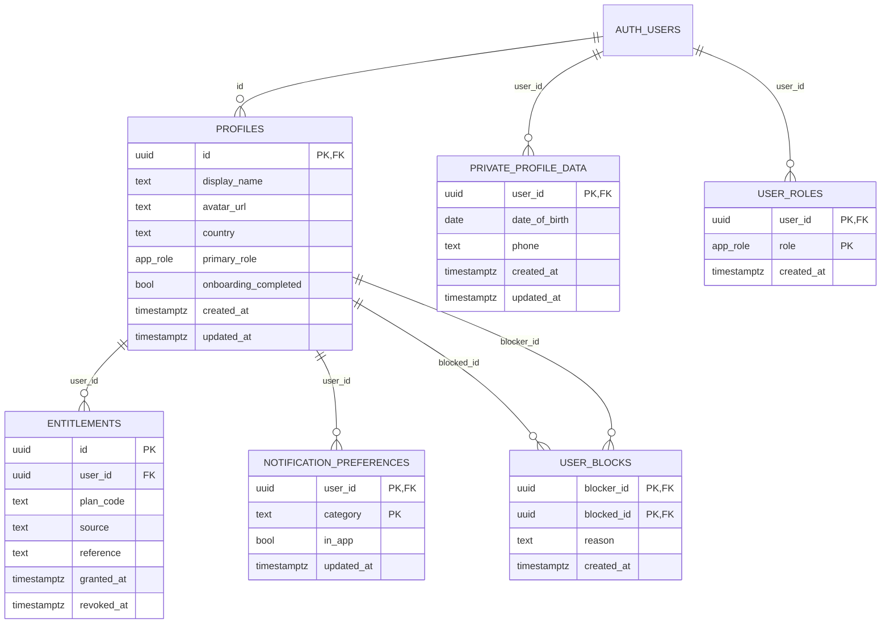

<!-- Generado por scripts/erd/generate.mjs a partir de las migraciones. No editar a mano: `npm run erd`. -->
# 01 · Identidad y cuentas

Tablas: **6** · RLS activada en 6/6.
Se relaciona con: `auth_users`.

## AS-IS · Modelo actual

## Inventario

| Tabla | Clasificación | Menores | Al borrar | Retención | Exportación RGPD | Decisión |
|---|---|---|---|---|---|---|
| `entitlements` | Personal | — | persona (user_id) → se borra | Mientras exista la cuenta | Sí | KEEP |
| `notification_preferences` | Personal | — | persona (user_id) → se borra | Mientras exista la cuenta | Sí | KEEP |
| `private_profile_data` | Sensible | Sí | persona (user_id) → se borra | Mientras exista la cuenta | Sí | KEEP |
| `profiles` | Personal | — | persona (id) → se borra | Mientras exista la cuenta | Sí | KEEP |
| `user_blocks` | Personal | — | persona (blocked_id) → se borra persona (blocker_id) → se borra | Mientras exista la cuenta | Sí | KEEP |
| `user_roles` | Personal | — | persona (user_id) → se borra | Mientras exista la cuenta | Sí | KEEP |

- `entitlements`: Planes contratados (Stripe).
- `private_profile_data`: Fecha de nacimiento y datos que nunca se muestran.
- `profiles`: 1:1 con auth.users. Nombre visible y avatar.

## TO-BE · Modelo objetivo

Sin cambios estructurales: el dominio se mantiene tal cual (KEEP). Las mejoras se limitan a convenciones (§7).
