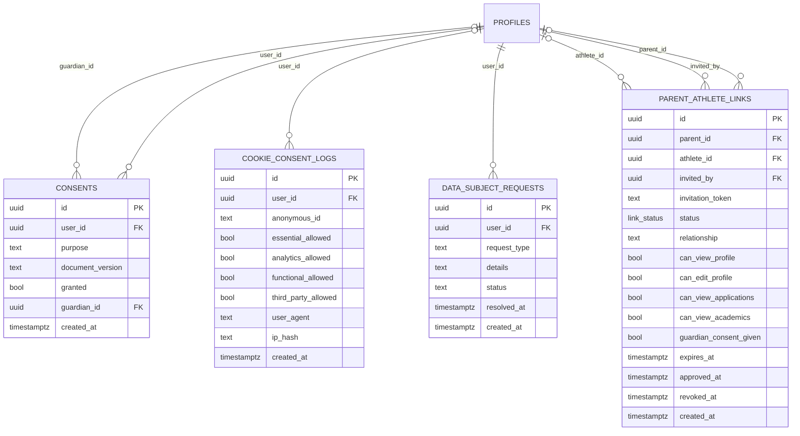

<!-- Generado por scripts/erd/generate.mjs a partir de las migraciones. No editar a mano: `npm run erd`. -->
# 02 · Familia, consentimiento y privacidad

Tablas: **4** · RLS activada en 4/4.
Se relaciona con: `profiles` (01).

## AS-IS · Modelo actual

## Inventario

| Tabla | Clasificación | Menores | Al borrar | Retención | Exportación RGPD | Decisión |
|---|---|---|---|---|---|---|
| `consents` | Sensible | Sí | persona (guardian_id) → se anonimiza persona (user_id) → se borra | Inmutable; se borra con la persona, el tutor se anonimiza | Sí | KEEP |
| `cookie_consent_logs` | Personal | — | persona (user_id) → se anonimiza | Inmutable; se anonimiza al borrar la cuenta | No: Registro técnico de cookies del navegador; solo lectura de Gala | KEEP |
| `data_subject_requests` | Personal | — | persona (user_id) → se borra | Mientras exista la cuenta | Sí | KEEP |
| `parent_athlete_links` | Sensible | Sí | persona (athlete_id) → se borra persona (invited_by) → se borra persona (parent_id) → se borra | Invitaciones pendientes: 90 días tras caducar | Sí | KEEP |

## TO-BE · Modelo objetivo

Sin cambios estructurales: el dominio se mantiene tal cual (KEEP). Las mejoras se limitan a convenciones (§7).
