<!-- Generado por scripts/erd/generate.mjs a partir de las migraciones. No editar a mano: `npm run erd`. -->
# 03 · Passport del atleta

Tablas: **18** · RLS activada en 18/18.
Se relaciona con: `organizations` (05), `profiles` (01), `sport_positions` (04), `sport_stat_definitions` (04), `sports` (04).

## AS-IS · Modelo actual

```mermaid
erDiagram
  ATHLETE_PROFILES ||--o{ ATHLETE_ACADEMICS : "athlete_id"
  ATHLETE_PROFILES ||--o{ ATHLETE_ACHIEVEMENTS : "athlete_id"
  ATHLETE_PROFILES ||--o{ ATHLETE_CAREER : "athlete_id"
  ATHLETE_PROFILES ||--o{ ATHLETE_DISCOVERY_SETTINGS : "athlete_id"
  ATHLETE_PROFILES ||--o{ ATHLETE_DOCUMENTS : "athlete_id"
  PROFILES |o--o{ ATHLETE_DOCUMENTS : "uploaded_by"
  ATHLETE_PROFILES ||--o{ ATHLETE_FINANCES : "athlete_id"
  ATHLETE_PROFILES ||--o{ ATHLETE_GOALS : "athlete_id"
  ATHLETE_PROFILES ||--o{ ATHLETE_LANGUAGES : "athlete_id"
  ATHLETE_PROFILES ||--o{ ATHLETE_LINKS : "athlete_id"
  PROFILES |o--o{ ATHLETE_LINKS : "verified_by"
  SPORT_POSITIONS |o--o{ ATHLETE_PROFILES : "primary_position_id"
  SPORT_POSITIONS |o--o{ ATHLETE_PROFILES : "secondary_position_id"
  SPORTS |o--o{ ATHLETE_PROFILES : "sport_id"
  PROFILES ||--o{ ATHLETE_PROFILES : "user_id"
  ATHLETE_PROFILES ||--o{ ATHLETE_STATISTICS : "athlete_id"
  SPORT_STAT_DEFINITIONS ||--o{ ATHLETE_STATISTICS : "stat_definition_id"
  ORGANIZATIONS |o--o{ ATHLETE_STATISTICS : "verified_by_org"
  ATHLETE_PROFILES ||--o{ ATHLETE_UPDATES : "athlete_id"
  ATHLETE_PROFILES ||--o{ ATHLETE_VIDEOS : "athlete_id"
  ATHLETE_PROFILES ||--o{ DOCUMENT_ACCESS_GRANTS : "athlete_id"
  ATHLETE_DOCUMENTS ||--o{ DOCUMENT_ACCESS_GRANTS : "document_id"
  PROFILES |o--o{ DOCUMENT_ACCESS_GRANTS : "granted_by"
  PROFILES |o--o{ DOCUMENT_ACCESS_GRANTS : "grantee_user_id"
  ORGANIZATIONS ||--o{ DOCUMENT_ACCESS_GRANTS : "organization_id"
  ATHLETE_PROFILES ||--o{ PASSPORT_FIELD_POLICIES : "athlete_id"
  ATHLETE_PROFILES ||--o{ PASSPORT_VIEWS : "athlete_id"
  PROFILES |o--o{ PASSPORT_VIEWS : "viewer_id"
  ORGANIZATIONS |o--o{ PASSPORT_VIEWS : "viewer_org_id"
  RECRUITING_LINKS ||--o{ RECRUITING_LINK_VIEWS : "link_id"
  ATHLETE_PROFILES ||--o{ RECRUITING_LINKS : "athlete_id"
  PROFILES |o--o{ RECRUITING_LINKS : "created_by"
  ATHLETE_ACADEMICS {
    uuid athlete_id PK,FK
    numeric gpa
    numeric gpa_scale
    numeric gpa_4
    text english_test
    text english_score
    int4 sat_score
    int4 act_score
    text school_year
    timestamptz updated_at
    text education_system
    text school_name
    text grade_display
    int4 toefl_score
    numeric ielts_score
    text cambridge_level
    int4 duolingo_score
    data_source gpa_source
    data_source english_source
    data_source tests_source
  }
  ATHLETE_ACHIEVEMENTS {
    uuid id PK
    uuid athlete_id FK
    text title
    int4 year
    text description
    data_source source
    timestamptz created_at
    text kind
    text level
  }
  ATHLETE_CAREER {
    uuid id PK
    uuid athlete_id FK
    text team
    text league
    text country
    text season_from
    text season_to
    text role
    timestamptz created_at
  }
  ATHLETE_DISCOVERY_SETTINGS {
    uuid athlete_id PK,FK
    text mode
    org_type_array organization_types
    opportunity_type_array opportunity_types
    text_array regions
    date visible_from
    date visible_until
    timestamptz updated_at
  }
  ATHLETE_DOCUMENTS {
    uuid id PK
    uuid athlete_id FK
    text kind
    text title
    date due_date
    text storage_path
    text mime_type
    int4 size_bytes
    uuid uploaded_by FK
    timestamptz uploaded_at
    timestamptz created_at
    text content_sha256
  }
  ATHLETE_FINANCES {
    uuid athlete_id PK,FK
    int4 annual_budget_usd
    timestamptz updated_at
    text budget_mode
  }
  ATHLETE_GOALS {
    uuid athlete_id PK,FK
    text_array pathways
    text_array countries
    text_array regions
    text_array intended_majors
    text school_size
    text sport_level
    text scholarship_need
    text campus_setting
    text start_term
    timestamptz updated_at
  }
  ATHLETE_LANGUAGES {
    uuid athlete_id PK,FK
    text language_code PK
    text level
  }
  ATHLETE_LINKS {
    uuid id PK
    uuid athlete_id FK
    text kind
    text url
    text label
    bool verified
    uuid verified_by FK
    timestamptz verified_at
    timestamptz created_at
  }
  ATHLETE_PROFILES {
    uuid user_id PK,FK
    text headline
    text bio
    text sport_id FK
    int4 primary_position_id FK
    int4 secondary_position_id FK
    int4 graduation_year
    int4 height_cm
    text dominant_side
    text current_team
    text competitive_level
    text city
    division_array target_divisions
    text intended_major
    bool open_to_opportunities
    text highlight_video_url
    visibility_level profile_visibility
    visibility_level academics_visibility
    visibility_level stats_visibility
    timestamptz created_at
    timestamptz updated_at
    text username
    text nationality
    int4 weight_kg
    text league
    int4 years_experience
    visibility_level sport_visibility
    visibility_level videos_visibility
    visibility_level goals_visibility
    text photo_path
  }
  ATHLETE_STATISTICS {
    uuid id PK
    uuid athlete_id FK
    int4 stat_definition_id FK
    text season
    numeric value
    data_source source
    timestamptz created_at
    text source_url
    uuid verified_by_org FK
    text team
    text competition
  }
  ATHLETE_UPDATES {
    uuid id PK
    uuid athlete_id FK
    text kind
    text body
    text link_url
    timestamptz created_at
    timestamptz expires_at
  }
  ATHLETE_VIDEOS {
    uuid id PK
    uuid athlete_id FK
    text kind
    text url
    text title
    text season
    bool is_featured
    timestamptz created_at
  }
  DOCUMENT_ACCESS_GRANTS {
    uuid id PK
    uuid document_id FK
    uuid athlete_id FK
    uuid organization_id FK
    uuid granted_by FK
    text purpose
    text context_type
    uuid context_id
    timestamptz expires_at
    timestamptz revoked_at
    timestamptz created_at
    uuid grantee_user_id FK
  }
  PASSPORT_FIELD_POLICIES {
    uuid athlete_id PK,FK
    text field_group PK
    bool allow_filter
    bool allow_match
    bool allow_compare
    bool allow_export
    timestamptz updated_at
  }
  PASSPORT_VIEWS {
    int8 id PK
    uuid athlete_id FK
    uuid viewer_id FK
    uuid viewer_org_id FK
    text viewer_kind
    date viewed_on
    timestamptz viewed_at
  }
  RECRUITING_LINK_VIEWS {
    int8 id PK
    uuid link_id FK
    timestamptz viewed_at
  }
  RECRUITING_LINKS {
    uuid id PK
    uuid athlete_id FK
    text token
    text label
    uuid created_by FK
    timestamptz expires_at
    timestamptz revoked_at
    timestamptz created_at
  }
```

## Inventario

| Tabla | Clasificación | Menores | Al borrar | Retención | Exportación RGPD | Decisión |
|---|---|---|---|---|---|---|
| `athlete_academics` | Sensible | Sí | atleta (athlete_id) → se borra | Mientras exista la cuenta | Sí | KEEP |
| `athlete_achievements` | Personal | Sí | atleta (athlete_id) → se borra | Mientras exista la cuenta | Sí | KEEP |
| `athlete_career` | Personal | Sí | atleta (athlete_id) → se borra | Mientras exista la cuenta | Sí | KEEP |
| `athlete_discovery_settings` | Personal | Sí | atleta (athlete_id) → se borra | Mientras exista la cuenta | Sí | KEEP |
| `athlete_documents` | Sensible | Sí | atleta (athlete_id) → se borra persona (uploaded_by) → se anonimiza | Mientras exista la cuenta | Sí | KEEP |
| `athlete_finances` | Sensible | Sí | atleta (athlete_id) → se borra | Mientras exista la cuenta | Sí | KEEP |
| `athlete_goals` | Personal | Sí | atleta (athlete_id) → se borra | Mientras exista la cuenta | Sí | KEEP |
| `athlete_languages` | Personal | Sí | atleta (athlete_id) → se borra | Mientras exista la cuenta | Sí | KEEP |
| `athlete_links` | Personal | Sí | atleta (athlete_id) → se borra persona (verified_by) → se anonimiza | Mientras exista la cuenta | Sí | KEEP |
| `athlete_profiles` | Personal | Sí | persona (user_id) → se borra | Mientras exista la cuenta | Sí | KEEP |
| `athlete_statistics` | Personal | Sí | atleta (athlete_id) → se borra organización (verified_by_org) → se anonimiza | Mientras exista la cuenta | Sí | KEEP |
| `athlete_updates` | Personal | Sí | atleta (athlete_id) → se borra | 30 días tras caducar | Sí | KEEP |
| `athlete_videos` | Personal | Sí | atleta (athlete_id) → se borra | Mientras exista la cuenta | Sí | KEEP |
| `document_access_grants` | Sensible | Sí | atleta (athlete_id) → se borra persona (granted_by) → se anonimiza persona (grantee_user_id) → se borra organización (organization_id) → se borra | Mientras exista la cuenta | No: Concesiones del atleta a organizaciones: visibles en Documentos; se exportarán con 11B | KEEP |
| `passport_field_policies` | Personal | Sí | atleta (athlete_id) → se borra | Mientras exista la cuenta | Sí | KEEP |
| `passport_views` | Personal | Sí | atleta (athlete_id) → se borra persona (viewer_id) → se anonimiza organización (viewer_org_id) → se anonimiza | Mientras exista la cuenta | No: Sin acceso directo (RLS): el atleta ve el resumen agregado en su Passport | KEEP |
| `recruiting_link_views` | Interna | — | En cascada con `recruiting_links` | Mientras exista la organización | No: Contador técnico de visitas al enlace, sin datos del visitante | KEEP |
| `recruiting_links` | Personal | Sí | atleta (athlete_id) → se borra persona (created_by) → se anonimiza | Mientras exista la cuenta | Sí | KEEP |

- `athlete_documents`: Exporta metadatos; los ficheros se descargan desde Documentos.
- `document_access_grants`: Acceso a un documento concreto, con propósito, contexto y caducidad.
- `recruiting_links`: El token no se exporta.

## TO-BE · Modelo objetivo

Sin cambios estructurales: el dominio se mantiene tal cual (KEEP). Las mejoras se limitan a convenciones (§7).
