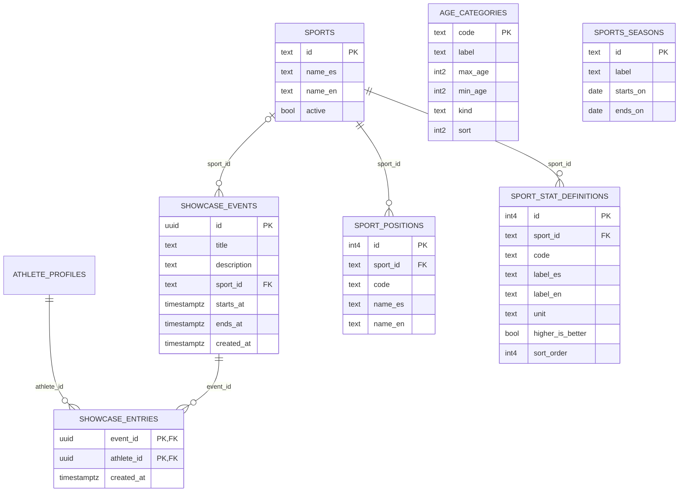

<!-- Generado por scripts/erd/generate.mjs a partir de las migraciones. No editar a mano: `npm run erd`. -->
# 04 · Catálogo deportivo y eventos

Tablas: **7** · RLS activada en 7/7.
Se relaciona con: `athlete_profiles` (03).

## AS-IS · Modelo actual

## Inventario

| Tabla | Clasificación | Menores | Al borrar | Retención | Exportación RGPD | Decisión |
|---|---|---|---|---|---|---|
| `age_categories` | Pública | — | No depende de personas | Mientras esté publicado o vigente | — | KEEP |
| `showcase_entries` | Personal | Sí | atleta (athlete_id) → se borra | Mientras exista la cuenta | Sí | KEEP |
| `showcase_events` | Pública | — | No depende de personas | Mientras esté publicado o vigente | — | KEEP |
| `sport_positions` | Pública | — | En cascada con `sports` | Mientras esté publicado o vigente | — | KEEP |
| `sport_stat_definitions` | Pública | — | En cascada con `sports` | Mientras esté publicado o vigente | — | KEEP |
| `sports` | Pública | — | No depende de personas | Mientras esté publicado o vigente | — | KEEP |
| `sports_seasons` | Pública | — | No depende de personas | Mientras esté publicado o vigente | — | KEEP |

- `age_categories`: Categorías U14…First Team con regla de edad cuando existe.
- `sports_seasons`: Temporadas normalizadas («2027-28»).

## TO-BE · Modelo objetivo

Sin cambios estructurales: el dominio se mantiene tal cual (KEEP). Las mejoras se limitan a convenciones (§7).
