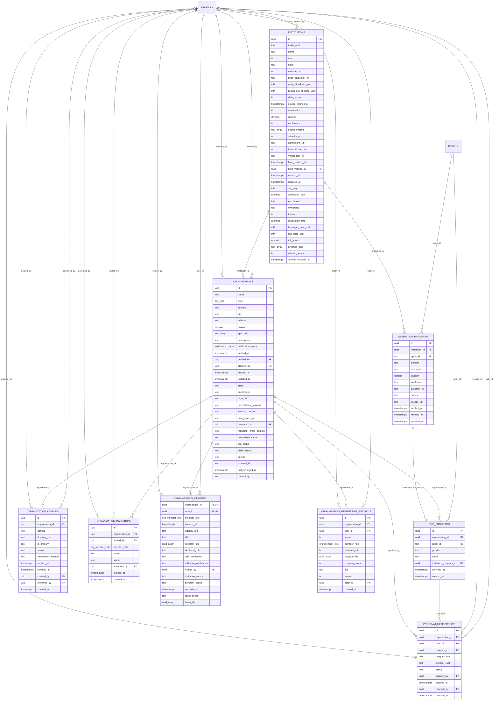

<!-- Generado por scripts/erd/generate.mjs a partir de las migraciones. No editar a mano: `npm run erd`. -->
# 05 · Instituciones y organizaciones

Tablas: **9** · RLS activada en 9/9.
Se relaciona con: `profiles` (01), `sports` (04).

## AS-IS · Modelo actual

## Inventario

| Tabla | Clasificación | Menores | Al borrar | Retención | Exportación RGPD | Decisión |
|---|---|---|---|---|---|---|
| `institution_programs` | Pública | — | En cascada con `institutions` | Mientras esté publicado o vigente | — | KEEP |
| `institutions` | Pública | — | persona (links_verified_by) → se anonimiza | Mientras esté publicado o vigente | — | KEEP |
| `org_programs` | Interna | — | organización (organization_id) → se borra | Mientras exista la organización | — | KEEP |
| `organization_domains` | Interna | — | persona (created_by) → se anonimiza organización (organization_id) → se borra persona (reviewed_by) → se anonimiza | Mientras exista la organización | — | KEEP |
| `organization_invitations` | Personal | — | persona (accepted_by) → se anonimiza persona (invited_by) → se borra organización (organization_id) → se borra | 90 días tras caducar si no se acepta | No: Invitación emitida por la organización | KEEP |
| `organization_members` | Personal | — | persona (invited_by) → se anonimiza organización (organization_id) → se borra persona (user_id) → se borra | Mientras exista la cuenta | Sí | KEEP |
| `organization_membership_records` | Interna | — | persona (actor_id) → se anonimiza organización (organization_id) → se borra persona (user_id) → se borra | Mientras exista la organización | No: Historial de la organización (altas, suspensiones) | KEEP |
| `organizations` | Interna | — | persona (created_by) → se anonimiza persona (verified_by) → se anonimiza | Mientras exista la organización | — | KEEP |
| `program_memberships` | Personal | — | persona (granted_by) → se anonimiza organización (organization_id) → se borra persona (revoked_by) → se anonimiza persona (user_id) → se borra | Mientras exista la cuenta | Sí | KEEP |

- `institution_programs`: Programas deportivos del catálogo.
- `institutions`: Catálogo de universidades reales (importado). No es una cuenta.
- `org_programs`: Programa dentro de la organización; enlaza a institution_programs.
- `organizations`: La cuenta (tenant) de universidad, club, agencia o marca. Enlaza a institutions.

## TO-BE · Modelo objetivo

Sin cambios estructurales: el dominio se mantiene tal cual (KEEP). Las mejoras se limitan a convenciones (§7).
