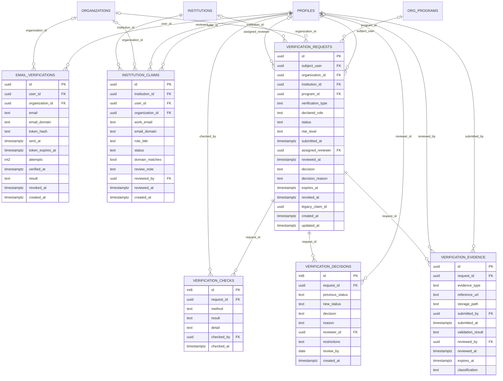

<!-- Generado por scripts/erd/generate.mjs a partir de las migraciones. No editar a mano: `npm run erd`. -->
# 06 · Verificación

Tablas: **6** · RLS activada en 6/6.
Se relaciona con: `institutions` (05), `org_programs` (05), `organizations` (05), `profiles` (01).

## AS-IS · Modelo actual

## Inventario

| Tabla | Clasificación | Menores | Al borrar | Retención | Exportación RGPD | Decisión |
|---|---|---|---|---|---|---|
| `email_verifications` | Personal | — | organización (organization_id) → se anonimiza persona (user_id) → se borra | Mientras exista la cuenta | Sí | KEEP |
| `institution_claims` | Personal | — | organización (organization_id) → se anonimiza persona (reviewed_by) → se anonimiza persona (user_id) → se borra | Mientras exista la cuenta | Sí | MERGE → verification_requests (tipo institution_claim) |
| `verification_checks` | Interna | — | persona (checked_by) → se anonimiza | Mientras exista la organización | No: Comprobaciones internas de Gala sobre la solicitud | KEEP |
| `verification_decisions` | Interna | — | persona (reviewer_id) → se anonimiza | Inmutable; el revisor se anonimiza | No: Decisión de Gala; el estado resultante se exporta en verification_requests | KEEP |
| `verification_evidence` | Sensible | — | persona (reviewed_by) → se anonimiza persona (submitted_by) → se borra | Mientras exista la cuenta | No: Se consulta en /app/verify; ficheros privados en Storage | KEEP |
| `verification_requests` | Sensible | — | persona (assigned_reviewer) → se anonimiza organización (organization_id) → se borra persona (subject_user) → se borra | Mientras exista la cuenta | Sí | KEEP |

- `email_verifications`: El hash del token no se exporta.

## TO-BE · Modelo objetivo

- `institution_claims` → **MERGE → verification_requests (tipo institution_claim)**. Plan: docs/DATA_ARCHITECTURE.md §6.
