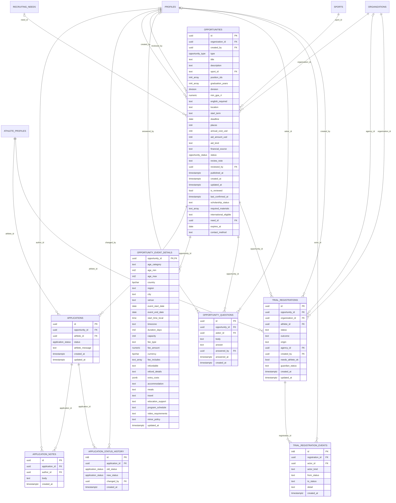

<!-- Generado por scripts/erd/generate.mjs a partir de las migraciones. No editar a mano: `npm run erd`. -->
# 07 · Oportunidades, candidaturas y trials

Tablas: **8** · RLS activada en 8/8.
Se relaciona con: `athlete_profiles` (03), `organizations` (05), `profiles` (01), `recruiting_needs` (09), `sports` (04).

## AS-IS · Modelo actual

## Inventario

| Tabla | Clasificación | Menores | Al borrar | Retención | Exportación RGPD | Decisión |
|---|---|---|---|---|---|---|
| `application_notes` | Interna | — | persona (author_id) → se anonimiza | Mientras exista la organización | No: Dato interno de la organización sobre el atleta: lo exporta la organización, no el atleta | KEEP |
| `application_status_history` | Personal | — | persona (changed_by) → se anonimiza | Inmutable; se borra con la candidatura | Sí | KEEP |
| `applications` | Personal | Sí | atleta (athlete_id) → se borra | Mientras exista la cuenta | Sí | KEEP |
| `opportunities` | Pública | — | persona (created_by) → se anonimiza organización (organization_id) → se borra persona (reviewed_by) → se anonimiza | Mientras esté publicado o vigente | — | KEEP |
| `opportunity_event_details` | Pública | — | En cascada con `opportunities` | Mientras esté publicado o vigente | — | KEEP |
| `opportunity_questions` | Personal | — | persona (answered_by) → se anonimiza persona (asker_id) → se anonimiza | Mientras exista la cuenta | No: Quién pregunta no es legible ni por el propio usuario (columnas restringidas) | KEEP |
| `trial_registration_events` | Interna | — | persona (actor_id) → se anonimiza | Mientras exista la organización | No: Historial de la inscripción; el estado se exporta en trial_registrations | KEEP |
| `trial_registrations` | Personal | Sí | organización (agency_id) → se anonimiza atleta (athlete_id) → se borra persona (created_by) → se anonimiza organización (organization_id) → se borra | Mientras exista la cuenta | Sí | KEEP |

- `application_status_history`: Se exporta dentro de applications.
- `opportunities`: Pública cuando está publicada; borrador interno.

## TO-BE · Modelo objetivo

Sin cambios estructurales: el dominio se mantiene tal cual (KEEP). Las mejoras se limitan a convenciones (§7).
