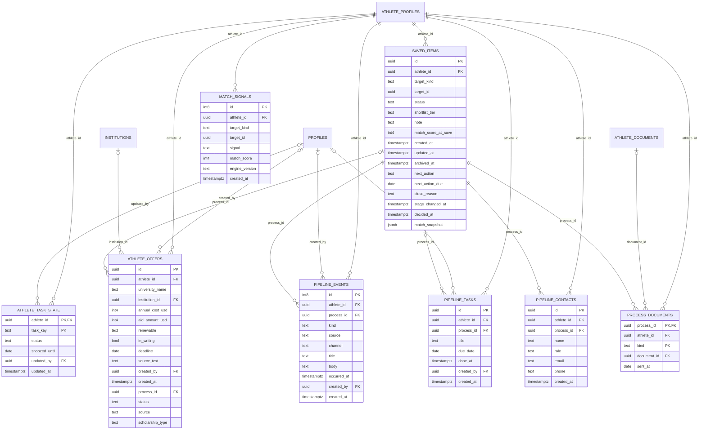

<!-- Generado por scripts/erd/generate.mjs a partir de las migraciones. No editar a mano: `npm run erd`. -->
# 08 · Pipeline del atleta y Gala Match

Tablas: **8** · RLS activada en 8/8.
Se relaciona con: `athlete_documents` (03), `athlete_profiles` (03), `institutions` (05), `profiles` (01).

## AS-IS · Modelo actual

## Inventario

| Tabla | Clasificación | Menores | Al borrar | Retención | Exportación RGPD | Decisión |
|---|---|---|---|---|---|---|
| `athlete_offers` | Sensible | Sí | atleta (athlete_id) → se borra persona (created_by) → se anonimiza | Mientras exista la cuenta | Sí | KEEP |
| `athlete_task_state` | Personal | Sí | atleta (athlete_id) → se borra persona (updated_by) → se anonimiza | Mientras exista la cuenta | Sí | KEEP |
| `match_signals` | Personal | Sí | atleta (athlete_id) → se borra | Mientras exista la cuenta | Sí | KEEP |
| `pipeline_contacts` | Personal | Sí | atleta (athlete_id) → se borra | Mientras exista la cuenta | Sí | KEEP |
| `pipeline_events` | Personal | Sí | atleta (athlete_id) → se borra persona (created_by) → se anonimiza | Mientras exista la cuenta | Sí | KEEP |
| `pipeline_tasks` | Personal | Sí | atleta (athlete_id) → se borra persona (created_by) → se anonimiza | Mientras exista la cuenta | Sí | KEEP |
| `process_documents` | Personal | Sí | atleta (athlete_id) → se borra | Mientras exista la cuenta | Sí | KEEP |
| `saved_items` | Personal | Sí | atleta (athlete_id) → se borra | Mientras exista la cuenta | Sí | RENAME → athlete_processes (diferido) |

- `saved_items`: Es el proceso del atleta, no un «guardado».

## TO-BE · Modelo objetivo

- `saved_items` → **RENAME → athlete_processes (diferido)**. Plan: docs/DATA_ARCHITECTURE.md §6.
