<!-- Generado por scripts/erd/generate.mjs a partir de las migraciones. No editar a mano: `npm run erd`. -->
# 09 · Discovery, shortlists y pipeline del staff

Tablas: **15** · RLS activada en 15/15.
Se relaciona con: `age_categories` (04), `applications` (07), `athlete_profiles` (03), `opportunities` (07), `opportunity_invitations` (14), `opportunity_registrations` (14), `org_programs` (05), `org_teams` (14), `organizations` (05), `profiles` (01), `sports` (04), `sports_seasons` (04).

## AS-IS · Modelo actual

```mermaid
erDiagram
  PROFILES ||--o{ DISCOVERY_USAGE : "user_id"
  PROFILES |o--o{ ORG_ACTIVITY : "actor_id"
  ATHLETE_PROFILES |o--o{ ORG_ACTIVITY : "athlete_id"
  ORGANIZATIONS ||--o{ ORG_ACTIVITY : "organization_id"
  PROFILES |o--o{ ORG_ASSIGNMENT_LOG : "assigned_by"
  PROFILES |o--o{ ORG_ASSIGNMENT_LOG : "assigned_to"
  ORGANIZATIONS ||--o{ ORG_ASSIGNMENT_LOG : "organization_id"
  APPLICATIONS |o--o{ ORG_CANDIDATES : "application_id"
  PROFILES |o--o{ ORG_CANDIDATES : "assigned_to"
  ATHLETE_PROFILES ||--o{ ORG_CANDIDATES : "athlete_id"
  PROFILES |o--o{ ORG_CANDIDATES : "created_by"
  OPPORTUNITY_INVITATIONS |o--o{ ORG_CANDIDATES : "invitation_id"
  RECRUITING_NEEDS |o--o{ ORG_CANDIDATES : "need_id"
  OPPORTUNITIES |o--o{ ORG_CANDIDATES : "opportunity_id"
  ORGANIZATIONS ||--o{ ORG_CANDIDATES : "organization_id"
  ORG_PROGRAMS |o--o{ ORG_CANDIDATES : "program_id"
  OPPORTUNITY_REGISTRATIONS |o--o{ ORG_CANDIDATES : "registration_id"
  ORG_TEAMS |o--o{ ORG_CANDIDATES : "team_id"
  PROFILES |o--o{ ORG_LABELS : "created_by"
  ORGANIZATIONS ||--o{ ORG_LABELS : "organization_id"
  ORG_PROGRAMS |o--o{ ORG_LABELS : "program_id"
  ATHLETE_PROFILES ||--o{ ORG_NOTES : "athlete_id"
  PROFILES |o--o{ ORG_NOTES : "author_id"
  ORGANIZATIONS ||--o{ ORG_NOTES : "organization_id"
  ORG_SHORTLISTS |o--o{ ORG_NOTES : "shortlist_id"
  PROFILES |o--o{ ORG_SAVED_SEARCHES : "created_by"
  RECRUITING_NEEDS |o--o{ ORG_SAVED_SEARCHES : "need_id"
  ORGANIZATIONS ||--o{ ORG_SAVED_SEARCHES : "organization_id"
  ORG_PROGRAMS |o--o{ ORG_SAVED_SEARCHES : "program_id"
  PROFILES |o--o{ ORG_SHORTLIST_MEMBER_LABELS : "added_by"
  ORG_LABELS ||--o{ ORG_SHORTLIST_MEMBER_LABELS : "label_id"
  ORG_SHORTLIST_MEMBERS ||--o{ ORG_SHORTLIST_MEMBER_LABELS : "shortlist_id"
  PROFILES |o--o{ ORG_SHORTLIST_MEMBERS : "added_by"
  PROFILES |o--o{ ORG_SHORTLIST_MEMBERS : "assigned_to"
  ATHLETE_PROFILES ||--o{ ORG_SHORTLIST_MEMBERS : "athlete_id"
  ORGANIZATIONS ||--o{ ORG_SHORTLIST_MEMBERS : "organization_id"
  ORG_CANDIDATES |o--o{ ORG_SHORTLIST_MEMBERS : "promoted_candidate_id"
  ORG_SHORTLISTS ||--o{ ORG_SHORTLIST_MEMBERS : "shortlist_id"
  RECRUITING_NEEDS |o--o{ ORG_SHORTLISTS : "need_id"
  OPPORTUNITIES |o--o{ ORG_SHORTLISTS : "opportunity_id"
  ORGANIZATIONS ||--o{ ORG_SHORTLISTS : "organization_id"
  PROFILES |o--o{ ORG_SHORTLISTS : "owner_id"
  ORG_PROGRAMS |o--o{ ORG_SHORTLISTS : "program_id"
  SPORTS |o--o{ ORG_SHORTLISTS : "sport_id"
  PROFILES |o--o{ ORG_TASKS : "assignee_id"
  ATHLETE_PROFILES |o--o{ ORG_TASKS : "athlete_id"
  ORG_CANDIDATES |o--o{ ORG_TASKS : "candidate_id"
  PROFILES |o--o{ ORG_TASKS : "created_by"
  RECRUITING_NEEDS |o--o{ ORG_TASKS : "need_id"
  OPPORTUNITIES |o--o{ ORG_TASKS : "opportunity_id"
  ORGANIZATIONS ||--o{ ORG_TASKS : "organization_id"
  ORG_SHORTLISTS |o--o{ ORG_TASKS : "shortlist_id"
  AGE_CATEGORIES |o--o{ RECRUITING_NEEDS : "age_category_code"
  PROFILES |o--o{ RECRUITING_NEEDS : "created_by"
  OPPORTUNITIES |o--o{ RECRUITING_NEEDS : "opportunity_id"
  ORGANIZATIONS ||--o{ RECRUITING_NEEDS : "organization_id"
  ORG_PROGRAMS |o--o{ RECRUITING_NEEDS : "program_id"
  SPORTS_SEASONS |o--o{ RECRUITING_NEEDS : "season_id"
  SPORTS ||--o{ RECRUITING_NEEDS : "sport_id"
  ORG_TEAMS |o--o{ RECRUITING_NEEDS : "team_id"
  ATHLETE_PROFILES ||--o{ SAVED_ATHLETES : "athlete_id"
  PROFILES ||--o{ SAVED_ATHLETES : "owner_id"
  PROFILES ||--o{ SAVED_SEARCHES : "owner_id"
  PROFILES |o--o{ SHORTLIST_ACCESS : "granted_by"
  ORGANIZATIONS ||--o{ SHORTLIST_ACCESS : "organization_id"
  ORG_SHORTLISTS ||--o{ SHORTLIST_ACCESS : "shortlist_id"
  PROFILES ||--o{ SHORTLIST_ACCESS : "user_id"
  DISCOVERY_USAGE {
    uuid user_id PK,FK
    date day PK
    int4 searches
  }
  ORG_ACTIVITY {
    int8 id PK
    uuid organization_id FK
    uuid athlete_id FK
    uuid actor_id FK
    text kind
    jsonb detail
    timestamptz created_at
  }
  ORG_ASSIGNMENT_LOG {
    int8 id PK
    uuid organization_id FK
    text target_kind
    uuid shortlist_id
    uuid athlete_id
    uuid candidate_id
    uuid assigned_to FK
    uuid assigned_by FK
    text status
    timestamptz created_at
  }
  ORG_CANDIDATES {
    uuid id PK
    uuid organization_id FK
    uuid athlete_id FK
    uuid program_id FK
    uuid need_id FK
    uuid opportunity_id FK
    uuid application_id FK
    text internal_stage
    uuid assigned_to FK
    text source
    text close_reason
    timestamptz archived_at
    uuid created_by FK
    timestamptz created_at
    timestamptz updated_at
    timestamptz stage_changed_at
    uuid team_id FK
    uuid registration_id FK
    uuid invitation_id FK
  }
  ORG_LABELS {
    uuid id PK
    uuid organization_id FK
    uuid program_id FK
    text name
    uuid created_by FK
    timestamptz created_at
  }
  ORG_NOTES {
    uuid id PK
    uuid organization_id FK
    uuid athlete_id FK
    uuid author_id FK
    text body
    timestamptz created_at
    uuid shortlist_id FK
    timestamptz updated_at
    timestamptz deleted_at
  }
  ORG_SAVED_SEARCHES {
    uuid id PK
    uuid organization_id FK
    uuid program_id FK
    uuid need_id FK
    uuid created_by FK
    text name
    jsonb filters
    int2 filters_version
    bool notify
    text visibility
    text status
    timestamptz last_executed_at
    timestamptz created_at
    timestamptz updated_at
  }
  ORG_SHORTLIST_MEMBER_LABELS {
    uuid shortlist_id PK,FK
    uuid athlete_id PK
    uuid label_id PK,FK
    uuid added_by FK
    timestamptz created_at
  }
  ORG_SHORTLIST_MEMBERS {
    uuid shortlist_id PK,FK
    uuid organization_id FK
    uuid athlete_id PK,FK
    int4 position
    text review_status
    bool priority
    uuid assigned_to FK
    int4 fit_at_add
    uuid added_by FK
    timestamptz added_at
    text source
    timestamptz last_reviewed_at
    text internal_label
    uuid promoted_candidate_id FK
    timestamptz promoted_at
  }
  ORG_SHORTLISTS {
    uuid id PK
    uuid organization_id FK
    uuid program_id FK
    uuid need_id FK
    text name
    text visibility
    uuid owner_id FK
    timestamptz archived_at
    timestamptz created_at
    timestamptz updated_at
    text description
    int4 recruiting_class
    text sport_id FK
    uuid opportunity_id FK
    text status
    timestamptz deleted_at
  }
  ORG_TASKS {
    uuid id PK
    uuid organization_id FK
    uuid athlete_id FK
    uuid opportunity_id FK
    text title
    date due_date
    text priority
    uuid assignee_id FK
    text status
    timestamptz done_at
    uuid created_by FK
    timestamptz created_at
    uuid shortlist_id FK
    uuid candidate_id FK
    uuid need_id FK
  }
  RECRUITING_NEEDS {
    uuid id PK
    uuid organization_id FK
    uuid program_id FK
    text title
    text sport_id FK
    int4_array position_ids
    int4_array class_years
    int4 slots
    int4 min_height_cm
    bool requires_video
    bool requires_documented_academics
    text_array countries
    text start_term
    text internal_notes
    text status
    uuid opportunity_id FK
    uuid created_by FK
    timestamptz created_at
    timestamptz updated_at
    uuid team_id FK
    text season_id FK
    text age_category_code FK
  }
  SAVED_ATHLETES {
    uuid owner_id PK,FK
    uuid athlete_id PK,FK
    text list_name PK
    text private_note
    timestamptz created_at
  }
  SAVED_SEARCHES {
    uuid id PK
    uuid owner_id FK
    text label
    jsonb filters
    bool alerts_enabled
    timestamptz last_seen_at
    timestamptz created_at
  }
  SHORTLIST_ACCESS {
    uuid shortlist_id PK,FK
    uuid organization_id FK
    uuid user_id PK,FK
    text access_role
    uuid granted_by FK
    timestamptz granted_at
    timestamptz revoked_at
  }
```

## Inventario

| Tabla | Clasificación | Menores | Al borrar | Retención | Exportación RGPD | Decisión |
|---|---|---|---|---|---|---|
| `discovery_usage` | Interna | — | persona (user_id) → se borra | Mientras exista la organización | Sí | KEEP |
| `org_activity` | Interna | — | persona (actor_id) → se anonimiza atleta (athlete_id) → se anonimiza organización (organization_id) → se borra | Inmutable; se anonimiza o se borra con la organización | — | KEEP |
| `org_assignment_log` | Interna | — | persona (assigned_by) → se anonimiza persona (assigned_to) → se anonimiza organización (organization_id) → se borra | Mientras exista la organización | — | KEEP |
| `org_candidates` | Interna | — | persona (assigned_to) → se anonimiza atleta (athlete_id) → se borra persona (created_by) → se anonimiza organización (organization_id) → se borra | Mientras exista la organización | No: Dato interno de la organización sobre el atleta: lo exporta la organización, no el atleta | KEEP |
| `org_labels` | Interna | — | persona (created_by) → se anonimiza organización (organization_id) → se borra | Mientras exista la organización | — | KEEP |
| `org_notes` | Interna | — | atleta (athlete_id) → se borra persona (author_id) → se anonimiza organización (organization_id) → se borra | Mientras exista la organización | No: Dato interno de la organización sobre el atleta: lo exporta la organización, no el atleta | KEEP |
| `org_saved_searches` | Interna | — | persona (created_by) → se anonimiza organización (organization_id) → se borra | Mientras exista la organización | — | KEEP |
| `org_shortlist_member_labels` | Interna | — | persona (added_by) → se anonimiza | Mientras exista la organización | — | KEEP |
| `org_shortlist_members` | Interna | — | persona (added_by) → se anonimiza persona (assigned_to) → se anonimiza atleta (athlete_id) → se borra organización (organization_id) → se borra | Mientras exista la organización | No: Dato interno de la organización sobre el atleta: lo exporta la organización, no el atleta | KEEP |
| `org_shortlists` | Interna | — | organización (organization_id) → se borra persona (owner_id) → se anonimiza | Mientras exista la organización | — | KEEP |
| `org_tasks` | Interna | — | persona (assignee_id) → se anonimiza atleta (athlete_id) → se anonimiza persona (created_by) → se anonimiza organización (organization_id) → se borra | Mientras exista la organización | — | KEEP |
| `recruiting_needs` | Interna | — | persona (created_by) → se anonimiza organización (organization_id) → se borra | Mientras exista la organización | — | KEEP |
| `saved_athletes` | Personal | — | atleta (athlete_id) → se borra persona (owner_id) → se borra | Mientras exista la cuenta | Sí | MERGE → org_shortlists privadas |
| `saved_searches` | Personal | — | persona (owner_id) → se borra | Mientras exista la cuenta | Sí | MERGE → org_saved_searches (solo para staff) |
| `shortlist_access` | Interna | — | persona (granted_by) → se anonimiza organización (organization_id) → se borra persona (user_id) → se borra | Mientras exista la organización | — | KEEP |

- `org_assignment_log`: Log inmutable: athlete_id, candidate_id y shortlist_id son referencias históricas sin FK (a propósito).
- `saved_athletes`: Listas personales anteriores a las shortlists.
- `saved_searches`: Ampliada en el Prompt 4 (búsqueda de talento) pese a la decisión de fusión: fase B1 de ARCHITECTURE-AUDIT.md.

## TO-BE · Modelo objetivo

- `saved_athletes` → **MERGE → org_shortlists privadas**. Plan: docs/DATA_ARCHITECTURE.md §6.
- `saved_searches` → **MERGE → org_saved_searches (solo para staff)**. Plan: docs/DATA_ARCHITECTURE.md §6.
