<!-- Generado por scripts/erd/generate.mjs a partir de las migraciones. No editar a mano: `npm run erd`. -->
# 10 · Agencias y clubes

Tablas: **22** · RLS activada en 22/22.
Se relaciona con: `athlete_documents` (03), `athlete_profiles` (03), `auth_users`, `institutions` (05), `opportunities` (07), `organizations` (05), `profiles` (01), `recruiting_links` (03), `sports` (04), `verification_requests` (06).

## AS-IS · Modelo actual

```mermaid
erDiagram
  ORGANIZATIONS ||--o{ AGENCY_ATHLETE_INVITES : "agency_id"
  AUTH_USERS |o--o{ AGENCY_ATHLETE_INVITES : "claimed_by"
  AUTH_USERS ||--o{ AGENCY_ATHLETE_INVITES : "invited_by"
  ORGANIZATIONS ||--o{ AGENCY_ATHLETE_NOTES : "agency_id"
  ATHLETE_PROFILES ||--o{ AGENCY_ATHLETE_NOTES : "athlete_id"
  PROFILES ||--o{ AGENCY_ATHLETE_NOTES : "author_id"
  ORGANIZATIONS ||--o{ AGENCY_CONTACTS : "agency_id"
  PROFILES |o--o{ AGENCY_CONTACTS : "created_by"
  INSTITUTIONS |o--o{ AGENCY_CONTACTS : "institution_id"
  SPORTS |o--o{ AGENCY_CONTACTS : "sport_id"
  PROFILES |o--o{ AGENCY_TRIALS : "extended_by"
  ORGANIZATIONS ||--o{ AGENCY_TRIALS : "organization_id"
  ORGANIZATIONS ||--o{ AGENT_REPRESENTATIONS : "agency_id"
  PROFILES ||--o{ AGENT_REPRESENTATIONS : "agent_id"
  ATHLETE_PROFILES ||--o{ AGENT_REPRESENTATIONS : "athlete_id"
  PROFILES |o--o{ AGENT_REPRESENTATIONS : "guardian_approved_by"
  OPPORTUNITIES |o--o{ AGENT_REPRESENTATIONS : "opportunity_id"
  PROFILES |o--o{ AGENT_REPRESENTATIONS : "revoked_by"
  ORGANIZATIONS ||--o{ CASE_OUTREACH : "agency_id"
  RECRUITING_CASES ||--o{ CASE_OUTREACH : "case_id"
  AGENCY_CONTACTS |o--o{ CASE_OUTREACH : "contact_id"
  PROFILES |o--o{ CASE_OUTREACH : "created_by"
  RECRUITING_LINKS |o--o{ CASE_OUTREACH : "link_id"
  ATHLETE_PROFILES ||--o{ CLUB_RECOMMENDATIONS : "athlete_id"
  PROFILES |o--o{ CLUB_RECOMMENDATIONS : "author_id"
  ORGANIZATIONS ||--o{ CLUB_RECOMMENDATIONS : "organization_id"
  ATHLETE_PROFILES ||--o{ CLUB_ROSTER : "athlete_id"
  ORGANIZATIONS ||--o{ CLUB_ROSTER : "organization_id"
  PROFILES ||--o{ CLUB_ROSTER_INVITES : "created_by"
  ORGANIZATIONS ||--o{ CLUB_ROSTER_INVITES : "organization_id"
  ATHLETE_PROFILES |o--o{ NEWS_POSTS : "athlete_id"
  PROFILES ||--o{ NEWS_POSTS : "author_id"
  ORGANIZATIONS |o--o{ NEWS_POSTS : "organization_id"
  ORGANIZATIONS |o--o{ PROFESSIONAL_CREDENTIALS : "organization_id"
  SPORTS |o--o{ PROFESSIONAL_CREDENTIALS : "sport_id"
  PROFILES ||--o{ PROFESSIONAL_CREDENTIALS : "user_id"
  VERIFICATION_REQUESTS |o--o{ PROFESSIONAL_CREDENTIALS : "verification_request_id"
  PROFILES |o--o{ RECRUITING_CASE_ACTIVITIES : "actor_id"
  RECRUITING_CASES ||--o{ RECRUITING_CASE_ACTIVITIES : "case_id"
  PROFILES |o--o{ RECRUITING_CASE_TASKS : "assignee_id"
  RECRUITING_CASES ||--o{ RECRUITING_CASE_TASKS : "case_id"
  PROFILES |o--o{ RECRUITING_CASE_TASKS : "created_by"
  ORGANIZATIONS ||--o{ RECRUITING_CASES : "agency_id"
  ATHLETE_PROFILES ||--o{ RECRUITING_CASES : "athlete_id"
  AGENCY_CONTACTS |o--o{ RECRUITING_CASES : "contact_id"
  INSTITUTIONS |o--o{ RECRUITING_CASES : "institution_id"
  PROFILES |o--o{ RECRUITING_CASES : "owner_id"
  SPORTS |o--o{ RECRUITING_CASES : "sport_id"
  PROFILES |o--o{ REPRESENTATION_AGREEMENTS : "created_by"
  ATHLETE_DOCUMENTS |o--o{ REPRESENTATION_AGREEMENTS : "document_id"
  AGENT_REPRESENTATIONS ||--o{ REPRESENTATION_AGREEMENTS : "representation_id"
  PROFILES |o--o{ REPRESENTATION_AGREEMENTS : "verified_by"
  ORGANIZATIONS ||--o{ REPRESENTATION_ASSIGNMENTS : "agency_id"
  PROFILES |o--o{ REPRESENTATION_ASSIGNMENTS : "assigned_by"
  AGENT_REPRESENTATIONS ||--o{ REPRESENTATION_ASSIGNMENTS : "representation_id"
  PROFILES ||--o{ REPRESENTATION_ASSIGNMENTS : "user_id"
  AGENT_REPRESENTATIONS ||--o{ REPRESENTATION_CONFLICTS : "conflicting_id"
  AGENT_REPRESENTATIONS ||--o{ REPRESENTATION_CONFLICTS : "representation_id"
  PROFILES |o--o{ REPRESENTATION_CONFLICTS : "resolved_by"
  AGENT_REPRESENTATIONS ||--o{ REPRESENTATION_COVERAGE : "representation_id"
  ORGANIZATIONS ||--o{ REPRESENTATION_FEE_ATTESTATIONS : "agency_id"
  PROFILES ||--o{ REPRESENTATION_FEE_ATTESTATIONS : "athlete_id"
  PROFILES |o--o{ REPRESENTATION_FEE_ATTESTATIONS : "attested_by"
  AGENT_REPRESENTATIONS ||--o{ REPRESENTATION_FEE_ATTESTATIONS : "representation_id"
  ORGANIZATIONS ||--o{ REPRESENTATION_INVITATIONS : "agency_id"
  AUTH_USERS ||--o{ REPRESENTATION_INVITATIONS : "athlete_id"
  AUTH_USERS ||--o{ REPRESENTATION_INVITATIONS : "invited_by"
  PROFILES |o--o{ REPRESENTATION_PERMISSIONS : "granted_by"
  AGENT_REPRESENTATIONS ||--o{ REPRESENTATION_PERMISSIONS : "representation_id"
  PROFILES |o--o{ REPRESENTATION_PERMISSIONS : "revoked_by"
  AGENCY_ATHLETE_INVITES {
    uuid id PK
    uuid agency_id FK
    uuid invited_by FK
    text full_name
    text email
    text sport
    int4 graduation_year
    text token_hash
    text status
    timestamptz opened_at
    timestamptz claimed_at
    uuid claimed_by FK
    timestamptz expires_at
    timestamptz created_at
  }
  AGENCY_ATHLETE_NOTES {
    uuid id PK
    uuid agency_id FK
    uuid athlete_id FK
    uuid author_id FK
    text kind
    text body
    date due_date
    bool done
    timestamptz done_at
    timestamptz created_at
    timestamptz updated_at
  }
  AGENCY_CONTACTS {
    uuid id PK
    uuid agency_id FK
    uuid institution_id FK
    text institution_name
    text sport_id FK
    text name
    text role_title
    text email
    text phone
    text notes
    uuid created_by FK
    timestamptz created_at
    timestamptz updated_at
  }
  AGENCY_TRIALS {
    uuid organization_id PK,FK
    timestamptz ends_at
    uuid extended_by FK
    text reason
    timestamptz updated_at
  }
  AGENT_REPRESENTATIONS {
    uuid id PK
    uuid agency_id FK
    uuid agent_id FK
    uuid athlete_id FK
    text status
    text message
    timestamptz responded_at
    timestamptz ended_at
    timestamptz created_at
    text representation_type
    text exclusivity_evidence
    date start_date
    date end_date
    uuid opportunity_id FK
    text source
    timestamptz accepted_at
    timestamptz guardian_approved_at
    uuid guardian_approved_by FK
    timestamptz activated_at
    timestamptz revoked_at
    uuid revoked_by FK
    timestamptz suspended_at
    text status_reason
    timestamptz updated_at
  }
  CASE_OUTREACH {
    uuid id PK
    uuid case_id FK
    uuid agency_id FK
    uuid contact_id FK
    text to_email
    text subject
    text body
    uuid link_id FK
    text status
    timestamptz sent_at
    timestamptz replied_at
    text note
    uuid created_by FK
    timestamptz created_at
    timestamptz updated_at
  }
  CLUB_RECOMMENDATIONS {
    uuid id PK
    uuid athlete_id FK
    uuid organization_id FK
    uuid author_id FK
    text body
    text status
    timestamptz created_at
    timestamptz decided_at
  }
  CLUB_ROSTER {
    uuid organization_id PK,FK
    uuid athlete_id PK,FK
    text season PK
    text status
    bool shares_progress
    timestamptz joined_at
    timestamptz ended_at
  }
  CLUB_ROSTER_INVITES {
    uuid id PK
    uuid organization_id FK
    uuid created_by FK
    text season
    text token
    int4 max_uses
    int4 uses
    text status
    timestamptz expires_at
    timestamptz created_at
  }
  NEWS_POSTS {
    uuid id PK
    uuid organization_id FK
    uuid author_id FK
    text kind
    text title
    text body
    text source_url
    uuid athlete_id FK
    timestamptz athlete_consented_at
    text status
    text hidden_reason
    timestamptz created_at
  }
  PROFESSIONAL_CREDENTIALS {
    uuid id PK
    uuid user_id FK
    uuid organization_id FK
    text issuing_body
    text credential_type
    text credential_number
    text country
    text sport_id FK
    date issued_on
    date expires_on
    text status
    uuid verification_request_id FK
    timestamptz verified_at
    timestamptz last_checked_at
    timestamptz created_at
    timestamptz updated_at
  }
  RECRUITING_CASE_ACTIVITIES {
    uuid id PK
    uuid case_id FK
    text kind
    text from_stage
    text to_stage
    text body
    date occurred_on
    uuid actor_id FK
    timestamptz created_at
  }
  RECRUITING_CASE_TASKS {
    uuid id PK
    uuid case_id FK
    text title
    uuid assignee_id FK
    date due_date
    bool done
    timestamptz done_at
    uuid created_by FK
    timestamptz created_at
  }
  RECRUITING_CASES {
    uuid id PK
    uuid agency_id FK
    uuid athlete_id FK
    uuid institution_id FK
    text institution_name
    text sport_id FK
    text cycle
    text stage
    uuid owner_id FK
    uuid contact_id FK
    text next_action
    date next_action_due
    text outcome_reason
    bool shared_with_athlete
    timestamptz created_at
    timestamptz updated_at
  }
  REPRESENTATION_AGREEMENTS {
    uuid id PK
    uuid representation_id FK
    int4 version
    uuid document_id FK
    date effective_from
    date effective_until
    text evidence_status
    text acceptance_status
    uuid created_by FK
    uuid verified_by FK
    timestamptz verified_at
    timestamptz created_at
  }
  REPRESENTATION_ASSIGNMENTS {
    uuid id PK
    uuid representation_id FK
    uuid agency_id FK
    uuid user_id FK
    text role
    uuid assigned_by FK
    timestamptz started_at
    timestamptz ended_at
  }
  REPRESENTATION_CONFLICTS {
    uuid id PK
    uuid representation_id FK
    uuid conflicting_id FK
    jsonb overlap
    text status
    timestamptz detected_at
    timestamptz resolved_at
    uuid resolved_by FK
    text resolution
  }
  REPRESENTATION_COVERAGE {
    uuid id PK
    uuid representation_id FK
    text dimension
    text value
    timestamptz created_at
  }
  REPRESENTATION_FEE_ATTESTATIONS {
    uuid id PK
    uuid representation_id FK
    uuid agency_id FK
    uuid athlete_id FK
    uuid attested_by FK
    text statement_version
    text statement
    timestamptz attested_at
  }
  REPRESENTATION_INVITATIONS {
    uuid id PK
    uuid agency_id FK
    uuid athlete_id FK
    uuid invited_by FK
    text status
    timestamptz expires_at
    timestamptz used_at
    timestamptz created_at
  }
  REPRESENTATION_PERMISSIONS {
    uuid id PK
    uuid representation_id FK
    text permission
    text status
    uuid granted_by FK
    timestamptz granted_at
    timestamptz expires_at
    uuid revoked_by FK
    timestamptz revoked_at
  }
  TERRITORY_REGIONS {
    text region PK
    text country PK
  }
```

## Inventario

| Tabla | Clasificación | Menores | Al borrar | Retención | Exportación RGPD | Decisión |
|---|---|---|---|---|---|---|
| `agency_athlete_invites` | Interna | Sí | organización (agency_id) → se borra persona (claimed_by) → se anonimiza persona (invited_by) → se borra | Mientras exista la organización | No: Invitación de la agencia a un atleta de su cartera (solo hash del enlace) | KEEP |
| `agency_athlete_notes` | Interna | — | organización (agency_id) → se borra atleta (athlete_id) → se borra persona (author_id) → se borra | Mientras exista la organización | No: Nota interna de la agencia sobre el atleta | KEEP |
| `agency_contacts` | Interna | — | organización (agency_id) → se borra persona (created_by) → se anonimiza | Mientras exista la organización | — | KEEP |
| `agency_trials` | Interna | — | persona (extended_by) → se anonimiza organización (organization_id) → se borra | Mientras exista la organización | No: Fin de la prueba gratuita de la agencia (dato de facturación de la organización) | KEEP |
| `agent_representations` | Sensible | Sí | organización (agency_id) → se borra persona (agent_id) → se borra atleta (athlete_id) → se borra persona (guardian_approved_by) → se anonimiza persona (revoked_by) → se anonimiza | Mientras exista la cuenta | Sí | KEEP |
| `case_outreach` | Interna | Sí | organización (agency_id) → se borra persona (created_by) → se anonimiza | Mientras exista la organización | No: Email de la agencia a un coach desde un proceso (texto con marcador, sin el enlace) | KEEP |
| `club_recommendations` | Personal | Sí | atleta (athlete_id) → se borra persona (author_id) → se anonimiza organización (organization_id) → se borra | Mientras exista la cuenta | Sí | KEEP |
| `club_roster` | Personal | Sí | atleta (athlete_id) → se borra organización (organization_id) → se borra | Mientras exista la cuenta | Sí | KEEP |
| `club_roster_invites` | Interna | — | persona (created_by) → se borra organización (organization_id) → se borra | 90 días tras caducar | — | MERGE → organization_invitations (tipo roster) |
| `news_posts` | Pública | — | atleta (athlete_id) → se borra persona (author_id) → se borra organización (organization_id) → se borra | Mientras esté publicado o vigente | — | KEEP |
| `professional_credentials` | Sensible | — | organización (organization_id) → se anonimiza persona (user_id) → se borra | Mientras exista la cuenta | Sí | KEEP |
| `recruiting_case_activities` | Interna | — | persona (actor_id) → se anonimiza | Mientras exista la organización | — | KEEP |
| `recruiting_case_tasks` | Interna | — | persona (assignee_id) → se anonimiza persona (created_by) → se anonimiza | Mientras exista la organización | — | KEEP |
| `recruiting_cases` | Interna | Sí | organización (agency_id) → se borra atleta (athlete_id) → se borra persona (owner_id) → se anonimiza | Mientras exista la organización | No: Caso interno de la agencia | KEEP |
| `representation_agreements` | Sensible | Sí | persona (created_by) → se anonimiza persona (verified_by) → se anonimiza | Mientras exista la cuenta | No: El documento del acuerdo ya se exporta con los documentos del atleta. | KEEP |
| `representation_assignments` | Sensible | Sí | organización (agency_id) → se borra persona (assigned_by) → se anonimiza persona (user_id) → se borra | Mientras exista la cuenta | Sí | KEEP |
| `representation_conflicts` | Interna | — | persona (resolved_by) → se anonimiza | Mientras exista la organización | — | KEEP |
| `representation_coverage` | Sensible | Sí | En cascada con `agent_representations` | Mientras exista la cuenta | No: Se identifica por la representación, no por la persona; el alcance va en representations. | KEEP |
| `representation_fee_attestations` | Interna | Sí | organización (agency_id) → se borra persona (athlete_id) → se borra persona (attested_by) → se anonimiza | Mientras exista la organización | No: Declaración de tarifas de la agencia (append-only; el atleta la ve en la propuesta) | KEEP |
| `representation_invitations` | Sensible | Sí | organización (agency_id) → se borra persona (athlete_id) → se borra persona (invited_by) → se borra | Mientras exista la cuenta | Sí | KEEP |
| `representation_permissions` | Sensible | Sí | persona (granted_by) → se anonimiza persona (revoked_by) → se anonimiza | Mientras exista la cuenta | No: Hija de la representación; sin columna de persona. | KEEP |
| `territory_regions` | Pública | — | No depende de personas | Mientras esté publicado o vigente | — | KEEP |

- `professional_credentials`: Licencias del agente; el número nunca es público.
- `representation_agreements`: Versiones del acuerdo.
- `representation_conflicts`: Revisión operativa de Gala, no jurídica.
- `representation_coverage`: Alcance de la representación.
- `representation_permissions`: Permisos concedidos por el atleta; historial conservado.
- `territory_regions`: Catálogo de regiones (Europa, Norteamérica, Latam).

## TO-BE · Modelo objetivo

- `club_roster_invites` → **MERGE → organization_invitations (tipo roster)**. Plan: docs/DATA_ARCHITECTURE.md §6.
