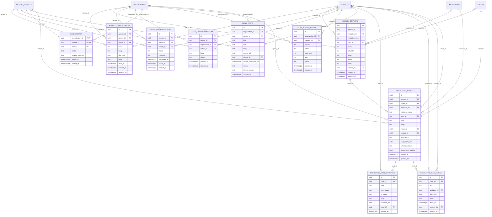

<!-- Generado por scripts/erd/generate.mjs a partir de las migraciones. No editar a mano: `npm run erd`. -->
# 10 · Agencias y clubes

Tablas: **10** · RLS activada en 10/10.
Se relaciona con: `athlete_profiles` (03), `institutions` (05), `organizations` (05), `profiles` (01), `sports` (04).

## AS-IS · Modelo actual

## Inventario

| Tabla | Clasificación | Menores | Al borrar | Retención | Exportación RGPD | Decisión |
|---|---|---|---|---|---|---|
| `agency_athlete_notes` | Interna | — | organización (agency_id) → se borra atleta (athlete_id) → se borra persona (author_id) → se borra | Mientras exista la organización | No: Nota interna de la agencia sobre el atleta | KEEP |
| `agency_contacts` | Interna | — | organización (agency_id) → se borra persona (created_by) → se anonimiza | Mientras exista la organización | — | KEEP |
| `agent_representations` | Sensible | Sí | organización (agency_id) → se borra persona (agent_id) → se borra atleta (athlete_id) → se borra | Mientras exista la cuenta | Sí | KEEP |
| `club_recommendations` | Personal | Sí | atleta (athlete_id) → se borra persona (author_id) → se anonimiza organización (organization_id) → se borra | Mientras exista la cuenta | Sí | KEEP |
| `club_roster` | Personal | Sí | atleta (athlete_id) → se borra organización (organization_id) → se borra | Mientras exista la cuenta | Sí | KEEP |
| `club_roster_invites` | Interna | — | persona (created_by) → se borra organización (organization_id) → se borra | 90 días tras caducar | — | MERGE → organization_invitations (tipo roster) |
| `news_posts` | Pública | — | atleta (athlete_id) → se borra persona (author_id) → se borra organización (organization_id) → se borra | Mientras esté publicado o vigente | — | KEEP |
| `recruiting_case_activities` | Interna | — | persona (actor_id) → se anonimiza | Mientras exista la organización | — | KEEP |
| `recruiting_case_tasks` | Interna | — | persona (assignee_id) → se anonimiza persona (created_by) → se anonimiza | Mientras exista la organización | — | KEEP |
| `recruiting_cases` | Interna | Sí | organización (agency_id) → se borra atleta (athlete_id) → se borra persona (owner_id) → se anonimiza | Mientras exista la organización | No: Caso interno de la agencia | KEEP |

## TO-BE · Modelo objetivo

- `club_roster_invites` → **MERGE → organization_invitations (tipo roster)**. Plan: docs/DATA_ARCHITECTURE.md §6.
