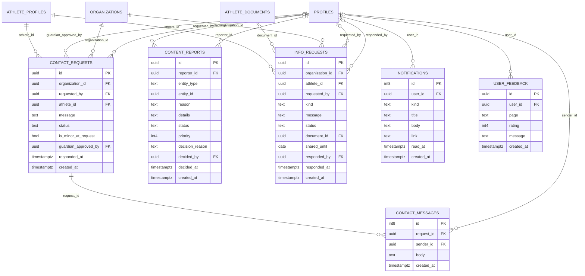

<!-- Generado por scripts/erd/generate.mjs a partir de las migraciones. No editar a mano: `npm run erd`. -->
# 11 · Comunicación, avisos y seguridad

Tablas: **6** · RLS activada en 6/6.
Se relaciona con: `athlete_documents` (03), `athlete_profiles` (03), `organizations` (05), `profiles` (01).

## AS-IS · Modelo actual

## Inventario

| Tabla | Clasificación | Menores | Al borrar | Retención | Exportación RGPD | Decisión |
|---|---|---|---|---|---|---|
| `contact_messages` | Personal | Sí | persona (sender_id) → se borra | Inmutable; se borra con la conversación o la cuenta | Sí | KEEP |
| `contact_requests` | Personal | Sí | atleta (athlete_id) → se borra persona (guardian_approved_by) → se anonimiza organización (organization_id) → se borra persona (requested_by) → se borra | Mientras exista la cuenta | Sí | KEEP |
| `content_reports` | Sensible | — | persona (decided_by) → se anonimiza persona (reporter_id) → se anonimiza | Mientras exista la cuenta | No: Denuncias: protegen a quien denuncia y a quien es denunciado | KEEP |
| `info_requests` | Personal | Sí | atleta (athlete_id) → se borra organización (organization_id) → se borra persona (requested_by) → se anonimiza persona (responded_by) → se anonimiza | Mientras exista la cuenta | Sí | KEEP |
| `notifications` | Personal | — | persona (user_id) → se borra | Leídas: 6 meses · todas: 12 meses | Sí | KEEP |
| `user_feedback` | Personal | — | persona (user_id) → se anonimiza | 24 meses | Sí | KEEP |

## TO-BE · Modelo objetivo

Sin cambios estructurales: el dominio se mantiene tal cual (KEEP). Las mejoras se limitan a convenciones (§7).
