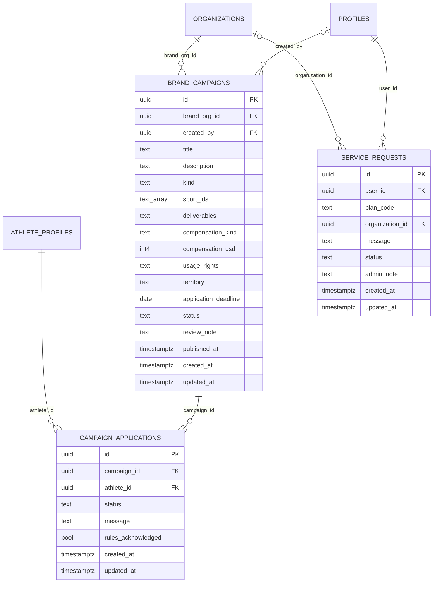

<!-- Generado por scripts/erd/generate.mjs a partir de las migraciones. No editar a mano: `npm run erd`. -->
# 12 · Marcas y negocio

Tablas: **3** · RLS activada en 3/3.
Se relaciona con: `athlete_profiles` (03), `organizations` (05), `profiles` (01).

## AS-IS · Modelo actual

## Inventario

| Tabla | Clasificación | Menores | Al borrar | Retención | Exportación RGPD | Decisión |
|---|---|---|---|---|---|---|
| `brand_campaigns` | Pública | — | organización (brand_org_id) → se borra persona (created_by) → se anonimiza | Mientras esté publicado o vigente | — | KEEP |
| `campaign_applications` | Personal | Sí | atleta (athlete_id) → se borra | Mientras exista la cuenta | Sí | KEEP |
| `service_requests` | Personal | — | organización (organization_id) → se anonimiza persona (user_id) → se borra | Mientras exista la cuenta | Sí | KEEP |

## TO-BE · Modelo objetivo

Sin cambios estructurales: el dominio se mantiene tal cual (KEEP). Las mejoras se limitan a convenciones (§7).
