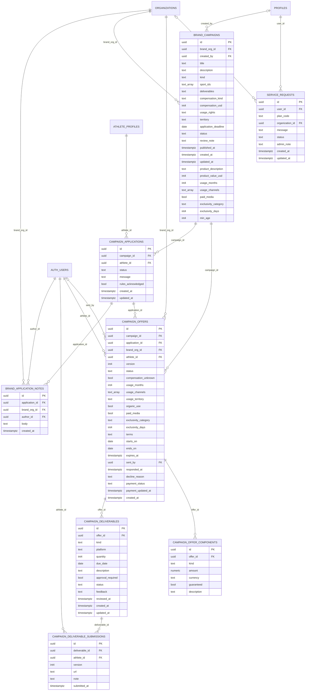

<!-- Generado por scripts/erd/generate.mjs a partir de las migraciones. No editar a mano: `npm run erd`. -->
# 12 · Marcas y negocio

Tablas: **8** · RLS activada en 8/8.
Se relaciona con: `athlete_profiles` (03), `auth_users`, `organizations` (05), `profiles` (01).

## AS-IS · Modelo actual

## Inventario

| Tabla | Clasificación | Menores | Al borrar | Retención | Exportación RGPD | Decisión |
|---|---|---|---|---|---|---|
| `brand_application_notes` | Interna | — | persona (author_id) → se borra organización (brand_org_id) → se borra | Mientras exista la organización | — | KEEP |
| `brand_campaigns` | Pública | — | organización (brand_org_id) → se borra persona (created_by) → se anonimiza | Mientras esté publicado o vigente | — | KEEP |
| `campaign_applications` | Personal | Sí | atleta (athlete_id) → se borra | Mientras exista la cuenta | Sí | KEEP |
| `campaign_deliverable_submissions` | Personal | — | persona (athlete_id) → se borra | Mientras exista la cuenta | Sí | KEEP |
| `campaign_deliverables` | Personal | — | En cascada con `campaign_offers` | Mientras exista la cuenta | No: Lo define la marca; lo del atleta (sus entregas) se exporta en campaign_deliverable_submissions. | KEEP |
| `campaign_offer_components` | Sensible | — | En cascada con `campaign_offers` | Mientras exista la cuenta | No: Hija de la oferta; se exporta dentro de campaign_offers. | KEEP |
| `campaign_offers` | Sensible | — | persona (athlete_id) → se borra organización (brand_org_id) → se borra persona (sent_by) → se anonimiza | Mientras exista la cuenta | Sí | KEEP |
| `service_requests` | Personal | — | organización (organization_id) → se anonimiza persona (user_id) → se borra | Mientras exista la cuenta | Sí | KEEP |

- `brand_application_notes`: Notas internas de la marca; nunca visibles para el atleta.
- `campaign_deliverable_submissions`: Versiones de cada entrega; nunca se sobrescriben.
- `campaign_deliverables`: Entregables de la oferta.
- `campaign_offer_components`: Producto ≠ dinero; bonus siempre condicionado.
- `campaign_offers`: Oferta inmutable; cambiarla crea versión nueva.

## TO-BE · Modelo objetivo

Sin cambios estructurales: el dominio se mantiene tal cual (KEEP). Las mejoras se limitan a convenciones (§7).
