<!-- Generado por scripts/erd/generate.mjs a partir de las migraciones. No editar a mano: `npm run erd`. -->
# 13 · IA, academia, analítica y auditoría

Tablas: **18** · RLS activada en 18/18.
Se relaciona con: `auth_users`, `organizations` (05), `profiles` (01), `safety_cases` (11).

## AS-IS · Modelo actual

```mermaid
erDiagram
  PROFILES ||--o{ ACADEMY_ATTEMPTS : "user_id"
  PROFILES ||--o{ ACADEMY_PROGRESS : "user_id"
  AUTH_USERS |o--o{ ADMIN_APPROVALS : "approved_by"
  AUTH_USERS ||--o{ ADMIN_APPROVALS : "requested_by"
  AUTH_USERS |o--o{ ADMIN_ROLES : "granted_by"
  AUTH_USERS ||--o{ ADMIN_ROLES : "user_id"
  PROFILES ||--o{ AI_CONVERSATIONS : "user_id"
  PROFILES ||--o{ AI_EVENTS : "user_id"
  AI_EVENTS ||--o{ AI_FEEDBACK : "request_id"
  PROFILES ||--o{ AI_FEEDBACK : "user_id"
  AI_CONVERSATIONS ||--o{ AI_MESSAGES : "conversation_id"
  PROFILES ||--o{ AI_MESSAGES : "user_id"
  PROFILES ||--o{ AI_PREFERENCES : "user_id"
  PROFILES ||--o{ AI_USAGE : "user_id"
  PROFILES |o--o{ AUDIT_LOGS : "actor_id"
  ORGANIZATIONS |o--o{ AUDIT_LOGS : "organization_id"
  AUTH_USERS ||--o{ BREAK_GLASS_GRANTS : "admin_id"
  SAFETY_CASES |o--o{ BREAK_GLASS_GRANTS : "case_id"
  AUTH_USERS |o--o{ BREAK_GLASS_GRANTS : "reviewed_by"
  AUTH_USERS ||--o{ BREAK_GLASS_GRANTS : "subject_user"
  AUTH_USERS |o--o{ FEATURE_FLAGS : "updated_by"
  PROFILES |o--o{ PRODUCT_EVENTS : "user_id"
  AUTH_USERS ||--o{ RATE_LIMIT_EVENTS : "user_id"
  AUTH_USERS ||--o{ REFERRAL_CODES : "user_id"
  AUTH_USERS ||--o{ REFERRALS : "referred_user"
  AUTH_USERS ||--o{ REFERRALS : "referrer_id"
  ACADEMY_ATTEMPTS {
    uuid id PK
    uuid user_id FK
    text exam
    int4 correct
    int4 total
    int4 duration_seconds
    timestamptz created_at
  }
  ACADEMY_PROGRESS {
    uuid user_id PK,FK
    text exam PK
    text topic_id PK
    timestamptz completed_at
  }
  ADMIN_APPROVALS {
    uuid id PK
    text action
    jsonb payload
    text reason
    uuid requested_by FK
    uuid approved_by FK
    text status
    timestamptz created_at
    timestamptz decided_at
    timestamptz expires_at
  }
  ADMIN_ROLES {
    uuid user_id PK,FK
    text role PK
    uuid granted_by FK
    timestamptz created_at
  }
  AI_CONVERSATIONS {
    uuid id PK
    uuid user_id FK
    text title
    timestamptz created_at
    timestamptz updated_at
  }
  AI_EVENTS {
    uuid id PK
    uuid user_id FK
    text intent
    text mode
    text outcome
    text provider
    text model
    int4 input_tokens
    int4 output_tokens
    int4 tool_calls
    int4 latency_ms
    text page
    timestamptz created_at
  }
  AI_FEEDBACK {
    uuid request_id PK,FK
    uuid user_id PK,FK
    int2 rating
    text reason
    timestamptz created_at
  }
  AI_MESSAGES {
    int8 id PK
    uuid conversation_id FK
    uuid user_id FK
    text role
    text content
    timestamptz created_at
  }
  AI_PREFERENCES {
    uuid user_id PK,FK
    bool save_history
    text language
    text answer_style
    timestamptz updated_at
  }
  AI_USAGE {
    uuid user_id PK,FK
    date day PK
    int4 requests
    timestamptz minute_start
    int4 minute_count
  }
  AUDIT_LOGS {
    int8 id PK
    uuid actor_id FK
    text action
    text entity
    uuid entity_id
    jsonb details
    timestamptz created_at
    uuid organization_id FK
    uuid program_id
    text actor_role
    text reason
    text classification
  }
  BREAK_GLASS_GRANTS {
    uuid id PK
    uuid admin_id FK
    uuid subject_user FK
    text reason
    uuid case_id FK
    timestamptz expires_at
    timestamptz created_at
    uuid reviewed_by FK
    timestamptz reviewed_at
  }
  FEATURE_FLAGS {
    text key PK
    bool enabled
    text description
    bool kill_switch
    uuid updated_by FK
    timestamptz updated_at
  }
  METRIC_DEFINITIONS {
    text key PK
    text name
    text definition
    text source
    int4 version
    timestamptz updated_at
  }
  PRODUCT_EVENTS {
    int8 id PK
    uuid user_id FK
    text event
    jsonb props
    timestamptz created_at
    text dedupe_key
  }
  RATE_LIMIT_EVENTS {
    int8 id PK
    uuid user_id FK
    text bucket
    timestamptz created_at
  }
  REFERRAL_CODES {
    uuid user_id PK,FK
    text code
    timestamptz created_at
  }
  REFERRALS {
    uuid referred_user PK,FK
    uuid referrer_id FK
    text code
    timestamptz created_at
  }
```

## Inventario

| Tabla | Clasificación | Menores | Al borrar | Retención | Exportación RGPD | Decisión |
|---|---|---|---|---|---|---|
| `academy_attempts` | Personal | — | persona (user_id) → se borra | Mientras exista la cuenta | Sí | KEEP |
| `academy_progress` | Personal | — | persona (user_id) → se borra | Mientras exista la cuenta | Sí | KEEP |
| `admin_approvals` | Interna | — | persona (approved_by) → se anonimiza persona (requested_by) → se borra | Mientras exista la organización | No: Doble aprobación interna de Gala | KEEP |
| `admin_roles` | Interna | — | persona (granted_by) → se anonimiza persona (user_id) → se borra | Mientras exista la organización | No: Roles internos de Gala | KEEP |
| `ai_conversations` | Personal | — | persona (user_id) → se borra | 90 días sin actividad; se borra al desactivar el historial | Sí | KEEP |
| `ai_events` | Interna | — | persona (user_id) → se borra | 13 meses | No: Telemetría técnica sin contenido de las preguntas | KEEP |
| `ai_feedback` | Personal | — | persona (user_id) → se borra | Mientras exista la cuenta | Sí | KEEP |
| `ai_messages` | Personal | — | persona (user_id) → se borra | Con su conversación | Sí | KEEP |
| `ai_preferences` | Personal | — | persona (user_id) → se borra | Mientras exista la cuenta | Sí | KEEP |
| `ai_usage` | Interna | — | persona (user_id) → se borra | 90 días | Sí | KEEP |
| `audit_logs` | Interna | — | persona (actor_id) → se anonimiza organización (organization_id) → se anonimiza | Inmutable; se anonimiza al borrar la cuenta | No: Registro de seguridad de Gala | KEEP |
| `break_glass_grants` | Interna | — | persona (admin_id) → se borra persona (reviewed_by) → se anonimiza persona (subject_user) → se borra | Mientras exista la organización | No: Acceso de emergencia de Gala: auditoría interna | KEEP |
| `feature_flags` | Pública | — | persona (updated_by) → se anonimiza | Mientras esté publicado o vigente | — | KEEP |
| `metric_definitions` | Interna | — | No depende de personas | Mientras exista la organización | — | KEEP |
| `product_events` | Personal | — | persona (user_id) → se borra | 13 meses | Sí | KEEP |
| `rate_limit_events` | Interna | — | persona (user_id) → se borra | 7 días | No: Contadores técnicos anti-spam (7 días) | KEEP |
| `referral_codes` | Personal | — | persona (user_id) → se borra | Mientras exista la cuenta | Sí | KEEP |
| `referrals` | Personal | — | persona (referred_user) → se borra persona (referrer_id) → se borra | Mientras exista la cuenta | Sí | KEEP |

- `feature_flags`: Interruptores de funcionalidad; no sustituyen permisos.
- `metric_definitions`: Definición escrita y versionada de cada métrica.
- `referral_codes`: Código de invitación (no para menores).
- `referrals`: Una atribución por persona; quien invita solo ve el número.

## TO-BE · Modelo objetivo

Sin cambios estructurales: el dominio se mantiene tal cual (KEEP). Las mejoras se limitan a convenciones (§7).
