<!-- Generado por scripts/erd/generate.mjs a partir de las migraciones. No editar a mano: `npm run erd`. -->
# 14 · Clubs & Academies: trials, programas y participación

Tablas: **13** · RLS activada en 13/13.
Se relaciona con: `age_categories` (04), `applications` (07), `athlete_offers` (08), `athlete_profiles` (03), `opportunities` (07), `org_candidates` (09), `org_programs` (05), `org_shortlists` (09), `organizations` (05), `profiles` (01), `sports_seasons` (04).

## AS-IS · Modelo actual

```mermaid
erDiagram
  OPPORTUNITIES ||--o{ ACADEMY_PROGRAM_DETAILS : "opportunity_id"
  ATHLETE_PROFILES ||--o{ OPPORTUNITY_ATTENDANCE : "athlete_id"
  OPPORTUNITIES ||--o{ OPPORTUNITY_ATTENDANCE : "opportunity_id"
  ORGANIZATIONS ||--o{ OPPORTUNITY_ATTENDANCE : "organization_id"
  PROFILES |o--o{ OPPORTUNITY_ATTENDANCE : "recorded_by"
  OPPORTUNITY_REGISTRATIONS ||--o{ OPPORTUNITY_ATTENDANCE : "registration_id"
  OPPORTUNITIES ||--o{ OPPORTUNITY_COST_COMPONENTS : "opportunity_id"
  PROFILES |o--o{ OPPORTUNITY_COST_COMPONENTS : "updated_by"
  ATHLETE_PROFILES ||--o{ OPPORTUNITY_INVITATIONS : "athlete_id"
  PROFILES |o--o{ OPPORTUNITY_INVITATIONS : "invited_by"
  OPPORTUNITIES ||--o{ OPPORTUNITY_INVITATIONS : "opportunity_id"
  ORGANIZATIONS ||--o{ OPPORTUNITY_INVITATIONS : "organization_id"
  ORG_SHORTLISTS |o--o{ OPPORTUNITY_INVITATIONS : "source_shortlist_id"
  ORG_TEAMS |o--o{ OPPORTUNITY_INVITATIONS : "team_id"
  ATHLETE_PROFILES ||--o{ OPPORTUNITY_OUTCOMES : "athlete_id"
  ORG_CANDIDATES |o--o{ OPPORTUNITY_OUTCOMES : "candidate_id"
  PROFILES |o--o{ OPPORTUNITY_OUTCOMES : "decided_by"
  OPPORTUNITIES ||--o{ OPPORTUNITY_OUTCOMES : "opportunity_id"
  ORGANIZATIONS ||--o{ OPPORTUNITY_OUTCOMES : "organization_id"
  OPPORTUNITY_REGISTRATIONS ||--o{ OPPORTUNITY_OUTCOMES : "registration_id"
  PROFILES |o--o{ OPPORTUNITY_REGISTRATION_EVENTS : "actor_id"
  OPPORTUNITY_REGISTRATIONS ||--o{ OPPORTUNITY_REGISTRATION_EVENTS : "registration_id"
  ORGANIZATIONS |o--o{ OPPORTUNITY_REGISTRATIONS : "agency_id"
  APPLICATIONS |o--o{ OPPORTUNITY_REGISTRATIONS : "application_id"
  ATHLETE_PROFILES ||--o{ OPPORTUNITY_REGISTRATIONS : "athlete_id"
  PROFILES |o--o{ OPPORTUNITY_REGISTRATIONS : "created_by"
  OPPORTUNITY_INVITATIONS |o--o{ OPPORTUNITY_REGISTRATIONS : "invitation_id"
  OPPORTUNITIES ||--o{ OPPORTUNITY_REGISTRATIONS : "opportunity_id"
  ORGANIZATIONS ||--o{ OPPORTUNITY_REGISTRATIONS : "organization_id"
  OPPORTUNITIES ||--o{ OPPORTUNITY_REQUIRED_MATERIALS : "opportunity_id"
  OPPORTUNITIES ||--o{ OPPORTUNITY_REQUIREMENTS : "opportunity_id"
  AGE_CATEGORIES |o--o{ ORG_TEAMS : "age_category_code"
  PROFILES |o--o{ ORG_TEAMS : "created_by"
  ORGANIZATIONS ||--o{ ORG_TEAMS : "organization_id"
  ORG_PROGRAMS ||--o{ ORG_TEAMS : "program_id"
  SPORTS_SEASONS |o--o{ ORG_TEAMS : "season_id"
  ATHLETE_PROFILES ||--o{ PAYMENT_REQUIREMENTS : "athlete_id"
  OPPORTUNITY_COST_COMPONENTS |o--o{ PAYMENT_REQUIREMENTS : "cost_component_id"
  PROGRAM_ENROLLMENTS |o--o{ PAYMENT_REQUIREMENTS : "enrollment_id"
  OPPORTUNITIES ||--o{ PAYMENT_REQUIREMENTS : "opportunity_id"
  ORGANIZATIONS ||--o{ PAYMENT_REQUIREMENTS : "organization_id"
  OPPORTUNITY_REGISTRATIONS |o--o{ PAYMENT_REQUIREMENTS : "registration_id"
  APPLICATIONS |o--o{ PROGRAM_ENROLLMENTS : "application_id"
  ATHLETE_PROFILES ||--o{ PROGRAM_ENROLLMENTS : "athlete_id"
  PROFILES |o--o{ PROGRAM_ENROLLMENTS : "created_by"
  ATHLETE_OFFERS |o--o{ PROGRAM_ENROLLMENTS : "offer_id"
  OPPORTUNITIES ||--o{ PROGRAM_ENROLLMENTS : "opportunity_id"
  ORGANIZATIONS ||--o{ PROGRAM_ENROLLMENTS : "organization_id"
  OPPORTUNITIES ||--o{ TRIAL_DETAILS : "opportunity_id"
  ACADEMY_PROGRAM_DETAILS {
    uuid opportunity_id PK,FK
    text program_kind
    text calendar_type
    text competition_level
    int2 training_sessions_per_week
    text competition_exposure
    text residential
    text accommodation
    text meals
    text education_support
    text_array language_support
    int4 capacity
    text price_status
    text financial_aid
    text minor_policy
    text requirements_note
    timestamptz updated_at
  }
  OPPORTUNITY_ATTENDANCE {
    uuid registration_id PK,FK
    uuid opportunity_id FK
    uuid organization_id FK
    uuid athlete_id FK
    text status
    timestamptz check_in_at
    timestamptz check_out_at
    uuid recorded_by FK
    timestamptz recorded_at
    text source
  }
  OPPORTUNITY_COST_COMPONENTS {
    uuid id PK
    uuid opportunity_id FK
    text component_type
    text label
    numeric amount
    bpchar currency
    bool required
    bool included
    text period
    text source
    int2 sort
    uuid updated_by FK
    timestamptz updated_at
  }
  OPPORTUNITY_INVITATIONS {
    uuid id PK
    uuid opportunity_id FK
    uuid organization_id FK
    uuid team_id FK
    uuid athlete_id FK
    uuid invited_by FK
    text source
    uuid source_shortlist_id FK
    text message
    text status
    bool guardian_required
    timestamptz sent_at
    timestamptz viewed_at
    timestamptz responded_at
    timestamptz expires_at
    timestamptz created_at
    timestamptz updated_at
  }
  OPPORTUNITY_OUTCOMES {
    uuid registration_id PK,FK
    uuid opportunity_id FK
    uuid organization_id FK
    uuid athlete_id FK
    text outcome
    text internal_note
    uuid candidate_id FK
    uuid decided_by FK
    timestamptz decided_at
  }
  OPPORTUNITY_REGISTRATION_EVENTS {
    int8 id PK
    uuid registration_id FK
    uuid actor_id FK
    text actor_kind
    text from_status
    text to_status
    text detail
    timestamptz created_at
  }
  OPPORTUNITY_REGISTRATIONS {
    uuid id PK
    uuid opportunity_id FK
    uuid organization_id FK
    uuid athlete_id FK
    text status
    text origin
    uuid agency_id FK
    uuid created_by FK
    bool needs_athlete_ok
    text guardian_status
    timestamptz created_at
    timestamptz updated_at
    uuid application_id FK
    uuid invitation_id FK
    timestamptz registered_at
    timestamptz confirmed_at
    timestamptz cancelled_at
    text cancellation_reason
    text cancelled_by_side
    text payment_status
    text materials_status
    text athlete_update
    timestamptz athlete_update_at
  }
  OPPORTUNITY_REQUIRED_MATERIALS {
    uuid id PK
    uuid opportunity_id FK
    text material
    text label
    bool required
    text visibility
    text provided_by
    bool requires_guardian_consent
    text sensitivity
    int2 valid_days
    timestamptz created_at
  }
  OPPORTUNITY_REQUIREMENTS {
    uuid id PK
    uuid opportunity_id FK
    text kind
    text strength
    jsonb params
    text label
    int2 sort
    timestamptz created_at
  }
  ORG_TEAMS {
    uuid id PK
    uuid organization_id FK
    uuid program_id FK
    text name
    text age_category_code FK
    text season_id FK
    timestamptz archived_at
    uuid created_by FK
    timestamptz created_at
  }
  PAYMENT_REQUIREMENTS {
    uuid id PK
    uuid organization_id FK
    uuid opportunity_id FK
    uuid athlete_id FK
    uuid registration_id FK
    uuid enrollment_id FK
    uuid cost_component_id FK
    text label
    numeric amount
    bpchar currency
    bool required
    date due_date
    text refundable
    date refund_deadline
    text status
    text provider_reference
    timestamptz created_at
    timestamptz updated_at
  }
  PROGRAM_ENROLLMENTS {
    uuid id PK
    uuid opportunity_id FK
    uuid organization_id FK
    uuid athlete_id FK
    uuid application_id FK
    uuid offer_id FK
    text status
    text guardian_status
    numeric aid_amount
    bpchar aid_currency
    date starts_on
    date ends_on
    timestamptz offered_at
    timestamptz accepted_at
    timestamptz enrolled_at
    timestamptz ended_at
    text end_reason
    uuid created_by FK
    timestamptz created_at
    timestamptz updated_at
  }
  TRIAL_DETAILS {
    uuid opportunity_id PK,FK
    text trial_type
    text registration_mode
    timestamptz registration_deadline
    text registration_status
    int4 capacity
    int4 min_participants
    text price_status
    text refundable
    date refund_deadline
    int2 refund_percentage
    text refund_policy
    text accommodation
    text meals
    text travel
    text equipment_requirements
    text minor_policy
    text video_requirements
    text additional_conditions
    timestamptz updated_at
  }
```

## Inventario

| Tabla | Clasificación | Menores | Al borrar | Retención | Exportación RGPD | Decisión |
|---|---|---|---|---|---|---|
| `academy_program_details` | Pública | — | En cascada con `opportunities` | Mientras esté publicado o vigente | — | KEEP |
| `opportunity_attendance` | Personal | Sí | atleta (athlete_id) → se borra organización (organization_id) → se borra persona (recorded_by) → se anonimiza | Mientras exista la cuenta | Sí | KEEP |
| `opportunity_cost_components` | Pública | — | persona (updated_by) → se anonimiza | Mientras esté publicado o vigente | — | KEEP |
| `opportunity_invitations` | Personal | Sí | atleta (athlete_id) → se borra persona (invited_by) → se anonimiza organización (organization_id) → se borra | Mientras exista la cuenta | Sí | KEEP |
| `opportunity_outcomes` | Interna | — | atleta (athlete_id) → se borra persona (decided_by) → se anonimiza organización (organization_id) → se borra | Mientras exista la organización | No: Resultado INTERNO del club; el atleta solo recibe el mensaje que el club comparte (opportunity_registrations.athlete_update) | KEEP |
| `opportunity_registration_events` | Interna | — | persona (actor_id) → se anonimiza | Mientras exista la organización | No: Historial de la inscripción; el estado se exporta en opportunity_registrations | KEEP |
| `opportunity_registrations` | Personal | Sí | organización (agency_id) → se anonimiza atleta (athlete_id) → se borra persona (created_by) → se anonimiza organización (organization_id) → se borra | Mientras exista la cuenta | Sí | KEEP |
| `opportunity_required_materials` | Pública | — | En cascada con `opportunities` | Mientras esté publicado o vigente | — | KEEP |
| `opportunity_requirements` | Pública | — | En cascada con `opportunities` | Mientras esté publicado o vigente | — | KEEP |
| `org_teams` | Interna | — | persona (created_by) → se anonimiza organización (organization_id) → se borra | Mientras exista la organización | — | KEEP |
| `payment_requirements` | Personal | — | atleta (athlete_id) → se borra organización (organization_id) → se borra | Mientras exista la cuenta | Sí | KEEP |
| `program_enrollments` | Personal | Sí | atleta (athlete_id) → se borra persona (created_by) → se anonimiza organización (organization_id) → se borra | Mientras exista la cuenta | Sí | KEEP |
| `trial_details` | Pública | — | En cascada con `opportunities` | Mientras esté publicado o vigente | — | KEEP |

- `academy_program_details`: Especialización 1:0..1 de un programa de academia.
- `opportunity_cost_components`: Todos los importes (obligatorios / opcionales / incluidos).
- `opportunity_registrations`: Antes trial_registrations (renombrada en 11A).
- `opportunity_required_materials`: Sustituye progresivamente a opportunities.required_materials (array legado).
- `opportunity_requirements`: Requisitos estructurados para Gala Match.
- `org_teams`: Equipo dentro de un programa de la misma organización.
- `payment_requirements`: Preparado para Stripe; sin datos bancarios.
- `trial_details`: Especialización 1:0..1 de una oportunidad de tipo trial (sustituye a opportunity_event_details).

## TO-BE · Modelo objetivo

Sin cambios estructurales: el dominio se mantiene tal cual (KEEP). Las mejoras se limitan a convenciones (§7).
